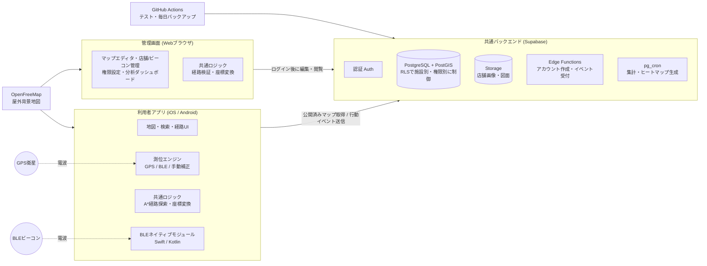

# 施設型マップ・屋内ナビゲーションアプリ 設計提案書 v0.1（承認待ち）

- 対象：初期PoC開発仕様書 v1.0「15. 最初の指示」への回答
- 作成：Claude Code（メイン開発担当）
- 作成日：2026-11-15
- ステータス：**承認待ち（この文書の承認まで本格実装は行いません）**
- レビュー依頼先：ChatGPT（設計・品質確認）、Gemini（技術調査・追加レビュー）

> 表記ルール
> - 【確定】仕様書に明記されている事項
> - 【提案】Claude Code からの提案。承認・却下・修正をお願いします
> - 【要確認】依頼者の判断・情報提供が必要な事項
> - 【要検証】Phase 1 の技術検証（スパイク）で実機確認してから確定する事項
> - 料金・無料枠の数値は 2026年11月時点の各社公開情報に基づく**概算**です。契約前に公式ページで必ず再確認します（1ドル＝150円で換算）。

---

## 目次

1. 要件の整理
2. 技術的な実現可能性の検証
3. 推奨技術構成の提案
4. 開発費用・運用費用の概算
5. BLE測位の実装上の課題
6. iOS・Android両対応における制約
7. データベース・権限設計
8. 開発工程と各工程の完成条件
9. リスク一覧
10. 依頼者に決めていただきたいこと（質問リスト）
11. 次のステップ（承認後に行うこと）

---

## 1. 要件の整理

### 1-1. システムの全体像

本システムは次の3つで構成されます。

| 構成要素 | 利用者 | 主な役割 |
|---|---|---|
| 利用者向けアプリ（iOS / Android） | 施設の来訪者 | マップ表示、店舗検索、現在地表示・補正、経路案内 |
| 管理画面（Webブラウザ、PC・スマホ） | 施設管理者・サービス運営者 | マップ編集、店舗管理、ビーコン管理、権限管理、分析閲覧 |
| 共通バックエンド | 両方から利用 | データ保存、認証、権限検証、公開データ配信、行動データ集計 |

### 1-2. PoCの範囲（1施設・1フロア）

PoCで「実際に動くもの」として作る範囲と、「設計だけ将来対応にしておく」範囲を分けます。

| 機能 | PoCで実装 | 将来対応（設計のみ先行） |
|---|---|---|
| 施設 | 1施設 | 複数施設（DB・権限は最初から複数施設前提） |
| フロア | 1フロア | 複数フロア・フロア間経路（データ構造は最初から対応） |
| マップ作成 | 管理画面で壁・通路・区画・設備を描画 | 図面からの自動変換（下記参照） |
| 図面取込 | PNG/JPEG/PDFを「下敷き」にしてなぞり描き、DXFの線を壁候補として取込 | DWG直接読込、画像からの自動ベクター化 |
| 屋外測位 | GPS取得・表示、施設エリア判定による屋内外切替 | 屋外の詳細な経路案内（施設まで） |
| 屋内測位 | BLEビーコン複数台による推定＋平滑化＋通路への補正 | 歩行者推測航法（PDR）・電波指紋方式による高精度化 |
| 現在地補正 | 確認ダイアログ＋手動指定、記録の区別 | 補正データを使った自動学習 |
| 経路案内 | A*による自動探索、通行禁止・一方通行・一時封鎖・指定ルート | 多フロア経路（エレベーター/階段）、バリアフリー経路 |
| 店舗情報 | 名称・画像・カテゴリ・営業時間・説明・所在地・詳細ページ・検索 | クーポン、多言語 |
| 行動データ | 仕様書の全項目を取得・集計・表示、ヒートマップ | 機械学習による分析、外部BIツール連携 |
| 管理画面 | ログイン、機能別ON/OFF権限、施設単位の分離、変更履歴 | SSO、組織（会社）単位の階層管理 |
| 公開 | TestFlight / Google Play内部テストでの配布 | App Store / Google Play 一般公開 |

### 1-3. 仕様書の要件を「機能要件」と「非機能要件」に整理

**機能要件**（第4〜9章）：マップ表示・編集、図面取込、GPS/BLE測位、現在地補正、自動/指定経路、店舗情報・検索、行動データ・ヒートマップ、ログイン・権限管理。

**非機能要件**（第2・10・11・13章）：
- 初期費用を可能な限り0円に近づける
- 将来の商用利用・複数施設展開に耐える
- サーバー側での権限検証（画面で隠すだけにしない）
- 施設ごとのデータ分離、個人情報の最小化、操作ログ、バックアップ
- 初心者の依頼者が引き継ぎ・運用できる（ドキュメントとわかりやすい構成）
- 各段階で動作する状態を維持し、テストで既存機能の破壊を防ぐ

---

## 2. 技術的な実現可能性の検証

判定：◎＝問題なく実現可能 ／ ○＝実現可能だが工夫が必要 ／ △＝条件付き・制約あり ／ ×＝PoCでは困難（代替案あり）

| 要件 | 判定 | 根拠・条件 |
|---|---|---|
| ベクターデータとしてのマップ管理（壁・通路・区画・設備） | ◎ | GeoJSON形式の図形データとしてDBに保存し、描画ライブラリで表示。一般的な屋内地図の標準的手法（Apple IMDF・OGC IndoorGMLと同じ考え方） |
| 管理画面からのマップ描画・編集 | ○ | Web上の図形編集ライブラリ（Terra Draw等）で実装可能。スナップや壁との交差チェックは独自実装が必要 |
| PNG/JPEG取込 | ◎ | 画像を下敷きとして表示し、2点を指定して縮尺（メートル）を合わせ、上からなぞって編集可能データを作成 |
| PDF取込 | ○ | ブラウザ内でPDFを画像化（pdf.js）して上記と同じ方式。ベクターPDFの線を直接抽出するのは図面ごとの差が大きく将来対応 |
| CAD（DXF）取込 | ○ | DXFはオープンな形式で、JavaScriptの解析ライブラリがある。線・ポリラインを「壁候補」として取込み、人が確認・修正する方式 |
| CAD（DWG）取込 | △ | DWGは非公開形式。無料の公式変換ツール（ODA File Converter）でDXFに変換してから取込む運用を提案 |
| 画像からの壁・店舗の完全自動認識 | × | 図面の描き方が施設ごとに違い、自動認識の精度は保証できない。**代替案**：下敷き＋なぞり描き（PoC）→ 将来、線検出による「下書き自動生成＋人が修正」を検討 |
| マップ変更履歴・元に戻す | ◎ | 「下書き→公開」方式で、公開ごとにスナップショットを保存。過去の版を再公開して復元 |
| GPS取得 | ◎ | iOS/Android標準機能。屋内では精度が大きく落ちるため屋外専用とする |
| 屋内外の自動切替 | ○ | 施設の敷地範囲（ポリゴン）とビーコン検出状況の組合せで判定。境界付近でのちらつき防止の工夫が必要 |
| BLEビーコン屋内測位 | ○ | iOS・Androidとも**アプリが前面表示中なら**実装可能。精度は一般的に2〜5m程度（設置密度・環境による）。詳細は第5章 |
| アプリを閉じている間の測位 | △ | OSの制約が強い。本仕様では前面表示中の測位で十分と判断（要件にもバックグラウンド測位はない） |
| 現在地確認・手動補正 | ◎ | UIと記録の実装のみ。測位元（GPS/BLE自動/手動確認/手動補正）を区別して保存 |
| A*/Dijkstraによる経路探索 | ◎ | 通路ネットワーク（点と線のグラフ）上で探索。施設規模なら端末内で一瞬で計算可能 |
| 壁を通過しない経路 | ◎ | 経路は「通路ネットワーク上だけ」を通るため壁を通らない。さらに管理画面で通路線が壁と交差したら警告 |
| 通行禁止・一方通行・一時封鎖・指定ルート | ◎ | 通路の属性と「規制ルール」（期間指定可）で実現 |
| 複数フロア経路 | ◎（設計） | エレベーター・階段を「フロア間をつなぐ通路」としてグラフに含めるだけで同じアルゴリズムが動く |
| 店舗情報・検索 | ◎ | 標準的なCRUDと全文検索 |
| 行動データ収集・集計・ヒートマップ | ◎ | イベントをDBに保存し、SQLで時間帯別・エリア別に集計 |
| 匿名化・同意取得 | ◎ | ログイン不要・ランダムIDのみ・初回同意画面・同意なしでも基本機能は利用可 |
| 機能別ON/OFF権限・施設単位アクセス制御 | ◎ | DBの行単位セキュリティ（Row Level Security）で**サーバー側**で強制 |
| 権限変更履歴・操作ログ | ◎ | DBトリガーで自動記録（アプリ側の書き忘れが起きない） |
| バックアップ・復旧 | △ | 無料枠のSupabaseには自動バックアップがない。**代替案**：GitHub Actions（無料）で毎日DBを書き出して保管。商用化時は有料プランの自動バックアップへ |
| 初期費用0円 | △ | ソフトウェア・サーバーは0円で開始可能。ただし **iPhoneでの実機テストにApple Developer Program（年額）が必要**、**BLEビーコン機器の購入**は避けられない（第4章） |

**結論**：仕様書の要件はすべて実現可能と判断します。ただし次の3点は仕様の「完全な形」ではなく代替方式を提案します（仕様変更ではなく、実装方法の提案です。承認をお願いします）。

1. 図面取込は「自動変換」ではなく「下敷き＋なぞり描き」「DXFの線を候補として取込→人が確認」を基本とする
2. BLE測位はアプリ前面表示中に限定する
3. 無料枠期間中のバックアップは自前の定期書き出しで代替する

---

## 3. 推奨技術構成の提案

### 3-1. 比較：モバイルアプリ（Flutter vs React Native）

| 観点 | Flutter（Dart） | React Native + Expo（TypeScript） |
|---|---|---|
| iOS/Android対応 | ◎ | ◎ |
| BLEビーコン（iOS） | iBeaconはOSの仕様上、汎用BLEライブラリでは受信できず、どちらもネイティブ部分（Swift）の実装が必要。既存パッケージはメンテナンス状況が不安定 | 同左。Expoの「ネイティブモジュール」機能で小さなSwift/Kotlinコードを追加する方式が整備されている |
| iOSアプリのビルド | 原則Macが必要（クラウドCIでも可能だが設定が複雑） | **EAS Build（クラウド）でMacなしでiOSビルド可能**、無料枠あり |
| 管理画面との共通化 | 管理画面をFlutter Webで作ると、地図編集系のWebライブラリが使いにくい | 管理画面（React）と**同じ言語TypeScriptで経路探索・測位計算・データ型を共有**できる |
| 地図描画 | flutter_map / maplibre_gl | @maplibre/maplibre-react-native（【要検証】最新版の安定性）、代替としてSVG/Skia描画 |
| 描画性能 | ◎ | ○（地図描画はネイティブライブラリが担うため実用上問題なし） |
| 保守性・人材 | Dart経験者はTypeScriptより少ない | JavaScript/TypeScriptは利用者が最も多く、引継ぎ先を探しやすい |
| アプリ更新 | ストア審査が必要 | 軽微な修正はOTA更新（EAS Update）でストア審査なしに配信可能（ネイティブ部分の変更は審査必要） |

【提案】**React Native + Expo（TypeScript）を採用**

採用理由：
- 経路探索・測位アルゴリズムを**1つのコードで**アプリと管理画面の両方に使え、テストも1か所で済む（バグの元が減る）
- MacがなくてもiOSアプリをビルドできる（依頼者のPC環境を問わない）
- 管理画面の地図編集に必要なWebライブラリ（MapLibre GL JS、Terra Draw、pdf.js、DXF解析）がすべてJavaScript製

Flutterを不採用とする理由は「劣っているから」ではなく、上記の共通化・ビルド環境の利点が本案件で大きいためです。

### 3-2. 比較：バックエンド（Supabase vs 自前PostgreSQL vs Firebase）

| 観点 | Supabase | 自前サーバー＋PostgreSQL | Firebase |
|---|---|---|---|
| 初期費用 | 無料枠あり | VPS代が月数百〜数千円 | 無料枠あり |
| データベース | PostgreSQL（標準SQL・移行容易） | PostgreSQL | 独自NoSQL（集計・結合が苦手） |
| 認証 | 組込み（パスワードは安全な方式でハッシュ保存、多要素認証対応） | 自作が必要（危険） | 組込み |
| サーバー側権限検証 | **行単位セキュリティ（RLS）でDB自体が拒否** | 自作 | セキュリティルール（独自言語） |
| 図形データ | PostGIS拡張が使える | 同左 | 弱い |
| 集計・ヒートマップ | SQLで高速集計、定期実行（pg_cron）あり | 同左 | 不得意、BigQuery連携が必要 |
| ベンダー依存 | 低い（中身は標準PostgreSQL。将来自前サーバーへ移行可能） | なし | 高い |
| 運用の手間 | 少ない | 多い（OS更新・監視・バックアップ全部自分） | 少ない |

【提案】**Supabase（PostgreSQL）を採用**。中身が標準のPostgreSQLなので、将来規模が大きくなっても他のクラウドや自前サーバーへ移行でき、「商用に耐えない技術」にはなりません。

### 3-3. 地図描画技術

| 選択肢 | 評価 |
|---|---|
| 画像を背景表示するだけ | ×（仕様書で不可とされている） |
| MapLibre（オープンソース地図エンジン） | ◎ 屋外地図と屋内地図を同じ画面でシームレスに表示可能、ベクターデータの拡大縮小が滑らか、無料・商用可 |
| 独自描画（SVG/Canvas） | ○ 屋内だけなら簡単だが、屋外地図との統合は自作になる |

【提案】**MapLibreを主に採用**。屋外の背景地図には**OpenFreeMap**（無料・APIキー不要・商用利用可、OpenStreetMapデータ）を使用。将来サービス停止リスクに備えて、背景地図の提供元は設定で差し替え可能にします（代替：MapTiler、Protomapsの自前配信）。
モバイル版MapLibreに問題があった場合の代替としてSVG/Skiaによる独自描画をPhase 1で比較検証します。

### 3-4. 座標の持ち方（重要な設計判断）

【提案】マップの図形・ビーコン位置は**「施設ごとのローカル座標（メートル単位のx, y）＋フロア」**で保存し、施設ごとに「原点の緯度経度・回転角」を1つ持ちます。表示時に緯度経度へ変換します。

理由：
- 図面はメートル単位、ビーコン設置位置も現地でメジャーで測れる値になる
- 測位・経路計算がメートル単位で単純になる（バグが減る）
- GPS精度に関係なく屋内地図の精度を保てる

### 3-5. 推奨技術構成（まとめ）

| 区分 | 採用技術 | 費用（PoC） |
|---|---|---|
| 言語 | TypeScript（全体共通） | 0円 |
| 利用者アプリ | React Native + Expo、MapLibre React Native、自作BLEネイティブモジュール（iOS: Swift/CoreLocation、Android: Kotlin/BLEスキャン） | 0円 |
| 管理画面 | React + Vite、MapLibre GL JS、Terra Draw（図形編集）、pdf.js、dxf-parser | 0円 |
| 共通ロジック | TypeScriptパッケージ（経路探索A*、測位計算、座標変換、データ型） | 0円 |
| バックエンド | Supabase（PostgreSQL + PostGIS、Auth、Storage、Edge Functions、pg_cron） | 0円（無料枠） |
| 管理画面ホスティング | Cloudflare Pages（無料枠で商用利用可。※Vercelの無料枠は商用不可のため不採用） | 0円 |
| アプリビルド・配布 | EAS Build / EAS Update、TestFlight、Google Play内部テスト | 0円（無料枠）＋ストア登録料 |
| 背景地図 | OpenFreeMap | 0円 |
| テスト | Vitest（ロジック）、pgTAP（DB権限）、Playwright（管理画面） | 0円 |
| ソース管理・CI | Git + GitHub、GitHub Actions | 0円 |
| エラー監視 | Sentry（無料枠） | 0円 |

### 3-6. システム構成図



### 3-7. フォルダ構成（予定）

```
/
├── apps/
│   ├── mobile/          利用者アプリ（Expo）
│   │   └── modules/beacon-scanner/   BLE測位ネイティブモジュール
│   └── admin/           管理画面（React + Vite）
├── packages/
│   ├── core/            共通ロジック（経路探索・測位計算・座標変換）＋単体テスト
│   └── shared-types/    DBの型定義（自動生成）
├── supabase/
│   ├── migrations/      DB定義の変更履歴（SQL）
│   ├── tests/           権限テスト（pgTAP）
│   ├── functions/       Edge Functions
│   └── seed/            開発用データ（※ダミーと明記）
├── docs/                設計書・API仕様・手順書・マニュアル
└── .github/workflows/   自動テスト・バックアップ
```

---

## 4. 開発費用・運用費用の概算

### 4-1. 開発費用（人件費以外）

開発作業はClaude Codeが行うため外注費は発生しません（依頼者がご利用中のAIサービス料金は除く）。

| 項目 | 費用 | 必須度 | 備考 |
|---|---|---|---|
| ソフトウェア・ライブラリ | 0円 | ― | すべてオープンソース／無料枠 |
| Supabase / Cloudflare / GitHub / EAS | 0円 | ― | 無料枠内 |
| **Apple Developer Program** | 年額 約15,000円（99ドル） | iPhone実機テストに必須 | MacなしでiPhone実機に入れるには登録が必要。Androidのみで先行開発し、Phase 3（測位）開始時に登録すれば費用発生を遅らせられる |
| **Google Play デベロッパー登録** | 約3,750円（25ドル、1回のみ） | Android配布に必要 | 開発中の実機テスト自体は無料（USB接続またはAPK直接インストール） |
| **BLEビーコン機器** | 1台 約2,000〜5,000円 × 必要台数 | 屋内測位の検証に必須 | 1フロアの規模による。目安は5〜10mに1台。例：50m×30m程度なら10〜20台で **約2万〜10万円** |
| ビーコン代替（開発初期のみ） | 0円 | 任意 | 手持ちのスマホをビーコンとして発信させるアプリで、初期の動作確認は可能。ただし精度評価には実機ビーコンが必要 |
| 独自ドメイン | 年額 約1,500〜3,000円 | 任意 | PoCでは不要（無料のサブドメインで可） |
| テスト用端末 | 0円〜 | ― | 手持ちのiPhone/Androidを使用。可能なら両OS各1台 |

**PoC最小構成の目安**：Android先行なら **約3,750円＋ビーコン代**、iOSも含めると **約19,000円＋ビーコン代**。

### 4-2. 運用費用

| 段階 | 構成 | 月額目安 |
|---|---|---|
| PoC（〜1施設、テスト利用） | すべて無料枠 | **0円**（＋Apple年額の月割 約1,250円） |
| 商用開始（数施設、月間利用者数千〜数万人） | Supabase Pro（25ドル〜）、他は無料枠 | **約4,000〜8,000円** |
| 拡大期（数十施設、月間利用者数十万人） | Supabase Pro＋計算資源追加、Cloudflare有料、Sentry有料等 | **約2万〜10万円**（データ量次第） |

### 4-3. 無料枠の注意点（PoC中に気をつけること）

- **Supabase無料枠は1週間アクセスがないと一時停止**します（データは消えません。管理画面から再開可能）。PoC期間中は定期的な自動アクセスで回避します。
- Supabase無料枠：DB容量 約500MB、ファイル保存 約1GB、プロジェクト2つまで（開発用・デモ用で使い切る）。
- **無料枠には自動バックアップがない**ため、GitHub Actionsで毎日DBを書き出して保管します（保管先：Cloudflare R2 無料枠10GB、暗号化して保存）。
- 行動データは件数が多くなりやすいため、生データは一定期間（例：90日）で集計済みデータに置き換え、容量を抑えます。
- **商用サービス開始前にはSupabase有料プランへの移行を推奨**します（自動バックアップ・停止なし・サポート）。

---

## 5. BLE測位の実装上の課題

### 5-1. 測位の仕組み（提案方式）

「最も近いビーコンを現在地とする」方式だけに依存しないよう、次の多段階処理にします。

```
① 受信     ：周囲のビーコンの電波強度（RSSI）を約1秒ごとに取得
② ノイズ除去：ビーコンごとに外れ値除去＋平滑化（移動中央値＋カルマンフィルタ）
③ 距離推定 ：電波の減衰モデルで「おおよその距離」に変換（ビーコンごとに較正値を保持）
④ 位置推定 ：強い順に3〜5台を使い、重み付き最小二乗法（トリラテレーション）で座標を計算
             2台以下しか見えない場合は重み付き重心法で代用、1台なら「そのビーコン付近」と表示し精度を低く表示
⑤ 補正     ：推定位置を「歩ける場所（通路・店舗内）」に寄せる（壁の中や壁の向こうに表示しない）
             前回位置からの移動速度が不自然なら抑制（人の歩行速度で上限）
⑥ 信頼度   ：使ったビーコン数・ばらつきから「精度の目安（半径◯m）」を計算し、地図上に円で表示
```

将来の高精度化（PoCでは設計のみ）：
- **歩行者推測航法（PDR）**：スマホの加速度・方位センサーで歩数と向きを推定し、ビーコン測位と組み合わせる（パーティクルフィルタ）
- **電波指紋方式**：施設内の各地点で事前に電波強度を記録し、照合する。利用者の手動補正データ（「正しい位置」と「その時の電波強度」の組）をこの学習データとして再利用できるよう、補正時に電波強度スナップショットも保存します（仕様書5-3の「将来の精度改善に利用」に対応）

### 5-2. 課題と対策

| 課題 | 内容 | 対策 |
|---|---|---|
| 電波の揺らぎ | RSSIは同じ場所でも±5〜10dBm揺れる。人体・壁・什器で遮られる | 平滑化、複数台使用、通路への補正、精度円の表示 |
| 端末差 | 機種ごとに受信感度が違う | 端末機種別の補正値を持てる設計。PoCでは主要2〜3機種で評価 |
| 設置密度と配置 | 少なすぎると精度不足、多すぎると費用増 | 5〜10m間隔、通路の分岐点・出入口に優先配置。管理画面で設置位置を地図上に登録 |
| 更新頻度と遅延 | 平滑化すると表示が遅れる | 平滑化の強さを調整可能にし、Phase 3で実測して決定 |
| ビーコン故障・電池切れ | 検出されなくなる、位置が別のビーコンと誤認される | ①測位側：見えないビーコンは自動で除外して残りで計算 ②管理側：各ビーコンの「最終検出日時」を匿名集計し、一定期間検出がなければ管理画面に警告表示 ③電池残量を発信する機種なら残量も表示 |
| ビーコンの移動・入れ替え | 登録座標と実際の位置がずれる | 管理画面で座標・状態（有効/無効/メンテナンス中）を変更可能に。履歴を記録 |
| なりすまし | 第三者が同じIDのビーコンを発信する | PoCでは対策の対象外とし、リスクとして明記。将来、ID変化型（暗号化）ビーコンの採用を検討 |
| 屋内外の切替 | 入口付近でGPSとBLEが交互に切り替わる | 施設エリア判定＋ビーコン検出台数＋一定時間の継続条件（ヒステリシス）で切替 |
| 電池消費 | 常時スキャンは端末の電池を消費 | 地図画面表示中のみスキャン、画面を離れたら停止 |

### 5-3. 推奨ビーコン規格・機種選定

- 【提案】**iBeacon形式**に対応したビーコンを採用（iOSで最も確実に扱える形式。Androidでも受信可能）
- 選定条件：iBeacon対応、送信出力・発信間隔を設定可能（100〜300ms推奨）、電池交換可能、可能なら電池残量通知対応、日本の技適マーク付き
- 【要確認】購入前に機種候補を提示し、承認をいただいてから購入をお願いします

### 5-4. 測位精度の評価方法（Phase 3で実施）

1. 施設内に評価地点（例：20地点）を決め、メジャーで正確な座標を記録
2. 各地点で30秒間アプリを静止させ、推定位置との誤差を記録（評価用モードを用意）
3. 指標：平均誤差、誤差の中央値、95%の地点での最大誤差、「正しい通路・店舗区画を当てた率」
4. 結果を表とグラフでテスト結果として提出
5. 【要確認】PoCの目標精度（例：中央値3m以内、店舗区画の正答率80%以上）を一緒に決めたい

---

## 6. iOS・Android両対応における制約

### 6-1. BLE関連

| 項目 | iOS | Android |
|---|---|---|
| ビーコン受信方式 | **iBeaconはCoreLocation（位置情報API）経由でのみ受信可能**。汎用BLE APIからは見えない。事前に登録したUUIDのビーコンだけを受信 | 汎用BLEスキャンで全形式受信可能 |
| 必要な許可 | 位置情報「使用中のみ許可」 | Android 12以降：「付近のデバイス」許可＋**正確な位置情報**許可（ビーコンから位置を推定する用途のため） |
| 受信頻度 | 約1秒ごと（OS固定） | 設定可能。ただし**スキャン開始/停止は30秒に5回まで**というOS制限あり |
| バックグラウンド | 大きく制限（測位用途には不向き） | 大きく制限（機種ごとの省電力機能でさらに制限） |
| 登録できるUUID数 | 監視は最大20領域。施設ごとに1つのUUIDに統一すれば問題なし | 制限なし |
| 開発・テスト | Bluetoothは**シミュレータで動かない**ため実機必須 | 同様に実機必須 |

→ 対策：**施設内のビーコンのUUIDを統一**し、Major/Minor番号で個体を識別する運用ルールにします。測位は「アプリ前面表示中」に限定します。

### 6-2. 開発・配布関連

| 項目 | iOS | Android |
|---|---|---|
| 実機テスト | Apple Developer Program（年額）登録＋EAS Build → TestFlight または端末登録で配布 | 無料。ビルドしたアプリを直接インストール可能 |
| Macの要否 | **不要**（EAS Buildのクラウドでビルド） | 不要 |
| 審査 | App Store審査あり（数日程度）。位置情報の利用目的説明文が必須 | Google Play審査あり。新規の個人アカウントは**公開前に一定人数・期間のクローズドテストが必須** |
| 個人情報の申告 | App Storeの「プライバシー情報」申告が必須 | Google Playの「データセーフティ」申告が必須 |
| 公開名義 | 個人登録だと販売者名が個人名で表示される。法人名義にはD-U-N-S番号が必要 | 個人/組織を選択 |

### 6-3. 開発ツール面の制約

- BLEネイティブモジュールを含むため、**Expo Go（お試しアプリ）では動作しません**。「開発ビルド」という専用アプリを一度作って実機に入れる必要があります（手順は都度詳しく説明します）。
- Claude Codeは実機を直接操作できません。**実機での動作確認は依頼者に操作していただく**必要があり、その際の手順書（どこを押して何を確認するか）を毎回用意します。

---

## 7. データベース・権限設計

### 7-1. 基本方針

1. **すべてのデータに `facility_id`（施設ID）を持たせる** → 施設をまたいだ閲覧・編集をDBレベルで遮断
2. **権限チェックはDB（RLS）で強制**し、管理画面のボタン非表示は「見た目の補助」に過ぎない扱いとする
3. 利用者アプリは**ログイン不要**。読める範囲は「公開済みの施設・マップ・店舗」のみ、書ける範囲は「行動イベントの追加」のみ
4. マップは**「下書き」と「公開版」を分離**。編集中の内容は利用者アプリに出ない。公開ごとに版を保存し、元に戻せる
5. 重要テーブルの変更はトリガーで**自動的に操作ログへ記録**

### 7-2. 主要テーブル（論理設計）

**施設・マップ系**

| テーブル | 主な項目 | 説明 |
|---|---|---|
| facilities | id, name, slug, status(下書き/公開/停止), origin_lat, origin_lng, rotation_deg, boundary(敷地範囲) | 施設 |
| floors | id, facility_id, level(階数), name, sort_order | フロア |
| map_features | id, facility_id, floor_id, kind, geometry, properties, store_id | 地図要素（下書き）。kind＝壁/通路/店舗区画/出入口/エレベーター/階段/エスカレーター/トイレ/障害物/その他設備 |
| map_versions | id, facility_id, floor_id, version_no, snapshot(JSON), status, note, published_by, published_at | 公開版のスナップショット。履歴・復元用 |
| floor_plan_imports | id, facility_id, floor_id, file_path, file_type, scale, offset, rotation | 取り込んだ図面（下敷き）とその位置合わせ情報 |

**店舗系**

| テーブル | 主な項目 | 説明 |
|---|---|---|
| store_categories | id, facility_id, name, icon, sort_order | カテゴリー |
| stores | id, facility_id, floor_id, category_id, name, name_kana, description, image_path, icon, opening_hours(JSON), is_visible, detail(JSON) | 店舗情報。地図上の区画とは map_features.store_id で紐づけ |

**経路系**

| テーブル | 主な項目 | 説明 |
|---|---|---|
| nav_nodes | id, facility_id, floor_id, x, y, kind(通常/出入口/エレベーター/階段/店舗入口), store_id | 通路ネットワークの点 |
| nav_edges | id, facility_id, from_node, to_node, direction(双方向/一方通行), cost_factor, accessible(段差なし), is_vertical(フロア間) | 通路ネットワークの線 |
| route_rules | id, facility_id, kind(通行禁止/一時封鎖/立入制限/推奨ルート), target_edges, target_area, starts_at, ends_at, is_active, note | 管理者指定の規制。期間指定可能で、**公開操作なしで即時反映** |

**測位系**

| テーブル | 主な項目 | 説明 |
|---|---|---|
| beacons | id, facility_id, floor_id, uuid, major, minor, x, y, z, tx_power, status(有効/無効/保守中), installed_at, last_seen_at, battery_level, note | ビーコン台帳 |
| position_corrections | id, facility_id, floor_id, anon_session_id, source(GPS/BLE自動/手動確認/手動補正), est_x, est_y, corrected_x, corrected_y, accuracy_m, beacon_snapshot(JSON), device_model, created_at | 現在地補正の記録（手動と自動を区別） |

**行動データ系**

| テーブル | 主な項目 | 説明 |
|---|---|---|
| analytics_events | id, facility_id, anon_session_id, event_type, floor_id, x, y, payload(JSON), platform, app_version, occurred_at | 生イベント（起動/マップ表示/店舗クリック/検索/経路検索 等）。90日で削除 |
| analytics_hourly | facility_id, date, hour, event_type, target_id, count | 時間帯別集計 |
| heatmap_cells | facility_id, floor_id, date, hour, cell_x, cell_y, count | ヒートマップ（例：2m四方のマス目ごとの件数） |
| search_keywords_daily | facility_id, date, keyword, count | 検索キーワード集計 |

※ `anon_session_id` は端末内で生成するランダムIDで、**一定期間（例：1日）ごとに作り直す**ことで長期的な個人追跡をできなくします。氏名・電話番号・広告IDなどは取得しません。ヒートマップでは件数が少なすぎるマス（例：5件未満）は表示しません。

**アカウント・権限系**

| テーブル | 主な項目 | 説明 |
|---|---|---|
| profiles | id(=認証ユーザーID), display_name, is_super_admin, is_active, created_at | 管理画面アカウント |
| permissions | key, label, description, category | 権限の一覧（マスタ） |
| facility_members | user_id, facility_id, created_by | どの施設に所属するか |
| user_permissions | user_id, facility_id, permission_key, granted_by, granted_at | **行がある＝ON、行がない＝OFF**（施設ごと） |
| permission_audit_log | id, actor_id, target_user_id, facility_id, permission_key, action(付与/解除), created_at | 権限変更履歴（変更不可・削除不可） |
| audit_log | id, actor_id, facility_id, table_name, record_id, action, before, after, created_at | 全般の操作ログ（自動記録） |

### 7-3. 権限一覧（ON/OFFスイッチの対象）

| キー | 画面表示名 | 内容 |
|---|---|---|
| map.view | マップ閲覧 | 下書きマップ・履歴の閲覧 |
| map.edit | マップ編集 | 図形の編集、公開、過去版への復元 |
| route.manage | 経路規制管理 | 通行禁止・一時封鎖・指定ルートの設定【提案：仕様書の一覧にないため追加提案。不要なら map.edit に含めます】 |
| store.view | 店舗情報閲覧 | |
| store.edit | 店舗情報編集 | 登録・編集・非表示・削除 |
| beacon.manage | ビーコン管理 | 台帳の閲覧・登録・編集 |
| userdata.view | 利用者データ閲覧 | 生データ（補正記録・イベント明細）の閲覧 |
| analytics.view | 分析データ閲覧 | 集計グラフ・ヒートマップの閲覧 |
| account.manage | アカウント管理 | 自施設のアカウント作成・停止 |
| permission.grant | 権限付与 | 自施設アカウントの権限ON/OFF |
| facility.edit | 施設情報編集 | 施設名・フロア・位置合わせ等の編集 |

**最上位管理者（is_super_admin）** は上記すべてを全施設で持ち、加えて「施設の新規作成」「最上位管理者の任命・解除」「システム設定」ができます。

### 7-4. 権限の安全ルール（サーバー側で強制）

1. 最上位管理者フラグは**最上位管理者しか変更できない**（画面にもDB関数にも、一般アカウント用の経路を作らない）
2. `permission.grant` を持つ一般アカウントは、**自分が持っている権限しか他人に付与できない**（権限の「水増し」防止）
3. 自分自身の権限は変更できない（最上位管理者を除く）
4. 他施設のアカウント・データには一切アクセスできない（RLSで遮断）
5. 最後の最上位管理者は削除・降格できない（締め出し防止）
6. 権限の付与・解除は専用のDB関数経由のみで行い、その中で上記をチェック＋履歴を自動記録
7. 最上位管理者のログインには**多要素認証（スマホのワンタイムコード）を必須**とする【提案】

### 7-5. 権限設定画面のイメージ

```
┌──────────────────────────────────┐
│ 山田 花子 さん ／ ◯◯ショッピングモール      │
├──────────────────────────────────┤
│ マップ閲覧                  [● ON ]       │
│ マップ編集                  [ OFF ○]       │
│ 店舗情報閲覧                [● ON ]       │
│ 店舗情報編集                [● ON ]       │
│ ビーコン管理                [ OFF ○]       │
│ …                                          │
│ ※あなたが持っていない権限は操作できません   │
│ 変更履歴を見る ›                           │
└──────────────────────────────────┘
```
スイッチを切り替えた瞬間にサーバーへ送信し、サーバーで拒否された場合はスイッチを元に戻してエラーを表示します。

### 7-6. 利用者アプリ向けAPI（概要）

API仕様書はPhase 2以降で詳細化しますが、方針は次のとおりです。

| 用途 | 方式 | 認可 |
|---|---|---|
| 公開済みマップ一式取得（地図・店舗・通路・ビーコン位置） | DB関数 `get_published_facility(facility_id)` → 1回のJSON取得、端末にキャッシュ（オフラインでも表示可） | 匿名・公開施設のみ |
| 有効な経路規制の取得 | `get_active_route_rules(facility_id)` | 匿名・公開施設のみ |
| 行動イベント送信 | Edge Function `ingest-events`（まとめて送信、回数制限あり） | 匿名・追加のみ・同意済みのみ |
| 現在地補正の送信 | 同上 | 同上 |
| 管理画面の各種操作 | Supabaseクライアント経由（RLSで制御）＋権限変更・アカウント作成は専用関数 | ログイン必須＋権限チェック |

### 7-7. セキュリティ対策一覧

| 要件（仕様書10章） | 対策 |
|---|---|
| ログイン認証 | Supabase Auth（メール＋パスワード）、最上位管理者は多要素認証 |
| パスワードの安全な管理 | bcryptでハッシュ化して保存（平文で保存しない）、最低文字数ルール |
| 権限検証・APIアクセス制御 | 全テーブルでRLS有効化、特権操作はDB関数内で再検証 |
| DBアクセス制御 | 管理用の秘密鍵（service_role）はサーバー側（Edge Functions）のみで使用、アプリ・画面には絶対に含めない |
| 施設ごとのデータ分離 | 全テーブルに facility_id、RLSで所属施設のみ許可。**「施設Aの担当者が施設Bを読めない」ことを自動テストで毎回確認** |
| 個人情報の最小化 | 利用者は匿名ID（定期的に作り直し）のみ。管理者もメールアドレス・表示名のみ |
| 操作ログ | トリガーで自動記録、ログは書換・削除不可 |
| バックアップ・データ復旧 | 毎日自動書き出し（無料期）→ 有料プランの自動バックアップ（商用期）。**復旧手順を実際に試して手順書化** |
| 不正アクセス対策 | ログイン試行回数制限、イベント受付の回数制限、依存ライブラリの脆弱性自動チェック、秘密情報のGit混入チェック |
| 同意取得 | 初回起動時に「位置情報・利用データの取得目的」を説明し同意を取得。同意しなくても地図・検索・経路は利用可能、測位とデータ送信のみ停止。プライバシーポリシー案を作成（※最終的な法的確認は専門家へ依頼を推奨） |

---

## 8. 開発工程と各工程の完成条件

### 8-1. 工程表

仕様書12章の Phase 1〜7 に沿います。ただし次の1点を【提案】します。

> 【提案・要承認】**Phase 2 の開始時点で、最小限のログイン（最上位管理者1名のみ）とサーバー側権限チェックを先に入れる**。
> 理由：マップ編集機能をログインなしで作ると、後から権限を後付けすることになり、作り直しや「権限チェック漏れ」の原因になるため。
> Phase 5 では予定どおり、アカウント管理・機能別ON/OFF権限・施設管理の画面を本格実装します。

| Phase | 内容 | 期間目安※ |
|---|---|---|
| 1 | 設計・環境構築・技術検証（スパイク） | 1〜2週間 |
| 2 | マップ基盤（表示・編集・店舗管理・図面取込・版管理） | 3〜4週間 |
| 3 | 位置情報（GPS・BLE測位・補正・精度評価） | 3〜4週間 |
| 4 | ルート案内（通路ネットワーク・A*・規制・表示） | 2〜3週間 |
| 5 | 管理システム（アカウント・権限・施設管理） | 2週間 |
| 6 | データ分析（イベント・集計・ヒートマップ） | 2週間 |
| 7 | 総合テスト・修正・ドキュメント整備 | 2〜3週間 |

※依頼者の確認・実機テストに使える時間、ビーコン購入・現地作業の日程で大きく変わります。合計 **約4〜5か月** を目安としてください。

### 8-2. 各工程の完成条件

各工程の終わりに「完成条件チェックリスト」「テスト結果」「依頼者向けの確認手順」を提出し、ChatGPT/Geminiのレビュー＋依頼者の承認を経て次工程に進みます。完成条件を満たすまで「完成」とは報告しません。

#### Phase 1：設計・環境構築
- [ ] 本設計書の承認
- [ ] Gitリポジトリにフォルダ構成・README・自動テストの仕組み（GitHub Actions）が整い、空のテストが通る
- [ ] Supabase開発用プロジェクトを作成し、最初のDB定義（施設・フロア・権限の土台）が適用されている
- [ ] 【技術検証】Androidの開発ビルドでビーコン（またはビーコン代わりのスマホ）の電波強度が画面に表示される
- [ ] 【技術検証】iOSでも同様に表示される（Apple Developer Program登録後。未登録の場合は「未検証」と明記）
- [ ] 【技術検証】スマホで、ローカル座標のサンプル図形がMapLibre上に表示される（MapLibre RNが不安定ならSVG描画との比較結果を報告）
- [ ] 依頼者のPCで開発環境を起動できる手順書がある

#### Phase 2：マップ基盤
- [ ] 最上位管理者でログインして管理画面に入れる（未ログインでは入れない）
- [ ] 管理画面で壁・通路・店舗区画・出入口・エレベーター・階段・トイレを描画・移動・削除できる
- [ ] PNG/JPEG/PDF図面を下敷きにして縮尺を合わせられる。DXFの線を壁候補として取り込める
- [ ] 店舗の登録・編集・非表示・削除・アイコン変更・区画変更ができる
- [ ] 「公開」すると利用者アプリに反映され、過去の版に戻すと元に戻る
- [ ] 利用者アプリで地図表示・拡大縮小・店舗タップで店舗情報・店舗詳細・名前/カテゴリ検索ができる
- [ ] 未ログインの通信から下書きデータ・編集APIにアクセスできないことを自動テストで確認

#### Phase 3：位置情報
- [ ] 屋外でGPS現在地が表示される
- [ ] 施設内でBLEにより現在地が表示され、精度円が表示される
- [ ] 屋内外の切替が入口付近でちらつかない
- [ ] 現在地更新ボタン→確認ダイアログ→「はい」で採用／「いいえ」で地図タップ指定、が動作する
- [ ] 自動測位と手動補正が区別してDBに記録されている
- [ ] ビーコン1台を停止しても測位が続き、管理画面で未検出警告が出る
- [ ] 管理画面でビーコンの登録・地図上配置・状態変更ができる
- [ ] 5-4の方法で精度評価を行い、結果（数値・グラフ・考察）を提出

#### Phase 4：ルート案内
- [ ] 管理画面で通路ネットワークを描画でき、壁と交差する線は警告される
- [ ] 利用者アプリで現在地（または任意地点）から店舗までの最短経路が地図に表示される
- [ ] 通行禁止・一方通行・一時封鎖（期間指定）・推奨ルートが経路に反映される（公開操作なしで反映）
- [ ] 経路が見つからない場合に適切なメッセージが出る
- [ ] 経路探索の自動テスト（壁を通らない、一方通行を逆走しない、封鎖を通らない、複数フロアのテスト用データでも動く）が通る

#### Phase 5：管理システム
- [ ] 最上位管理者がアカウントを作成・停止できる
- [ ] 施設ごとに、機能別ON/OFFスイッチで権限を設定できる
- [ ] 権限OFFの機能は画面に表示されず、**かつ**直接API/DBを叩いても拒否される（自動テストで全権限×全操作を確認）
- [ ] 施設Aの管理者が施設Bのデータを閲覧・編集できない（自動テスト）
- [ ] 一般アカウントが最上位管理者権限を付与できない、自分にない権限を付与できない（自動テスト）
- [ ] 権限変更履歴・操作ログが管理画面で確認できる
- [ ] 施設情報・フロア情報の編集ができる

#### Phase 6：データ分析
- [ ] 初回起動時の同意画面があり、同意しない場合はデータが送信されない
- [ ] 仕様書8章の全項目（起動数・マップ表示数・店舗クリック数・検索数・検索キーワード・経路検索数・目的地別・利用位置・時間帯別）が記録される
- [ ] 管理画面で期間・時間帯を指定してグラフ表示できる
- [ ] ヒートマップを時間帯別・店舗周辺別・通路別・エリア別に表示できる
- [ ] 少数件のマスが表示されない（匿名性の確保）
- [ ] 生データの自動削除と集計が定期実行される

#### Phase 7：総合テスト
- [ ] iOS実機・Android実機でのテスト項目表をすべて実施し、結果を記録
- [ ] PC（Chrome/Safari/Edge）とスマホブラウザで管理画面のテストを実施
- [ ] 現地でのBLE測位テスト（Phase 3の評価を再実施）
- [ ] セキュリティ確認（権限テスト、秘密鍵の混入チェック、依存ライブラリの脆弱性チェック）
- [ ] バックアップからの復旧を実際に試験
- [ ] 成果物（仕様書14章）がすべて揃っている：ソースコード一式、DB設計書、API仕様書、構成図、セットアップ手順書、操作マニュアル、テスト結果、README、Git履歴

### 8-3. 実装状況の表記ルール（第13章-4への対応）

各工程の報告では全機能を次の4区分で一覧表示します。

| 表記 | 意味 |
|---|---|
| ✅ 実装済み | 動作確認・テスト済み |
| 🟡 仮実装 | 動くが制約あり（例：ダミーデータで確認、iOS未検証）。制約内容を必ず併記 |
| ⬜ 未実装 | まだ作っていない |
| ❌ 実装不可・代替 | 理由と代替案を併記 |

開発用のサンプルデータは、名前に「【サンプル】」を付け、DB上でもサンプルである印（`is_sample` 等）を持たせて実データと混同しないようにします。

### 8-4. 作業の進め方（AI分担）

1. Claude Code が工程ごとに作業ブランチで実装し、変更内容の説明を書く
2. その説明と差分を ChatGPT（設計・品質）・Gemini（調査・追加レビュー）に貼ってレビューしていただく
3. 指摘を Claude Code に伝えていただき、修正
4. 依頼者が手順書どおりに実機・画面で動作確認
5. 承認後に統合（Gitに記録）

---

## 9. リスク一覧

| リスク | 影響 | 対策 |
|---|---|---|
| BLE測位精度が期待に届かない | 高 | 目標値を事前合意、精度円の表示で過信を防ぐ、手動補正機能、将来のPDR/電波指紋方式を設計済み |
| 施設側のビーコン設置許可が得られない | 高 | 【要確認】PoC施設との調整状況を確認。代替として依頼者の手配可能な場所（自宅・事務所等）での検証 |
| 無料サービスの規約・料金変更 | 中 | 標準技術（PostgreSQL、MapLibre）を採用し移行可能に。背景地図の提供元を差し替え可能に |
| MapLibreのReact Native版の不具合 | 中 | Phase 1で検証、代替のSVG/Skia描画を用意 |
| ストア審査で差し戻し | 中 | 位置情報利用目的の明記、プライバシー申告、同意画面を最初から設計 |
| 依頼者の実機確認の負担 | 中 | 手順書を毎回用意、確認項目を絞る、ロジック部分は自動テストで担保 |
| 図面の形式が想定外 | 中 | 【要確認】PoC施設の図面形式を早めに入手 |
| 個人情報・位置情報の法的リスク | 中 | 匿名化・最小化・同意取得。プライバシーポリシーは専門家確認を推奨 |

---

## 10. 依頼者に決めていただきたいこと（質問リスト）

承認時に、以下もあわせてご回答ください。分からない項目は「分からない」で大丈夫です。その場合は推奨案で進めます。

| # | 質問 | 推奨案 |
|---|---|---|
| Q1 | 本設計（React Native + Expo / Supabase / MapLibre）で進めてよいですか？ | 推奨構成で進める |
| Q2 | Phase 2の最初に最小限のログインを先行実装する提案（8-1）を承認しますか？ | 承認 |
| Q3 | 開発にお使いのPCはWindowsですか、Macですか？ | ― |
| Q4 | テストに使えるスマホは何ですか？（例：iPhone 13 / Pixel 7 など、両OSあるか） | 両OS各1台 |
| Q5 | Apple Developer Programへの登録時期はいつがよいですか？個人名義か法人名義か？ | Phase 1後半〜Phase 3開始時に登録 |
| Q6 | PoCの対象施設は決まっていますか？ビーコン設置の許可は取れそうですか？ | ― |
| Q7 | 対象フロアの図面はありますか？形式は（DWG/DXF/PDF/画像/なし）？おおよその広さは？ | ― |
| Q8 | ビーコン購入予算の上限はいくらですか？ | 機種候補と台数見積を後日提示 |
| Q9 | PoCの目標測位精度に希望はありますか？ | 中央値3m以内・店舗区画正答率80% |
| Q10 | 権限一覧に「経路規制管理（route.manage）」を追加してよいですか？ | 追加 |
| Q11 | 最上位管理者の多要素認証を必須にしてよいですか？ | 必須 |
| Q12 | 利用者アプリの対応言語は日本語のみでよいですか？（多言語化できる作りにはしておきます） | PoCは日本語のみ |
| Q13 | 車いす・ベビーカー向け経路（段差回避）はPoCに含めますか？ | データ項目のみ用意し、機能は将来 |
| Q14 | 行動データの生データ保存期間は90日でよいですか？ | 90日 |

---

## 11. 次のステップ（承認後に行うこと）

1. ご回答を反映した設計書 v1.0 を作成
2. Phase 1 開始：
   - フォルダ構成・README・自動テストの作成
   - 依頼者のPCへの開発環境導入（Node.js、VS Code拡張、Git等）を画面ごとの手順で案内
   - Supabase無料アカウント・プロジェクト作成を手順付きで案内
   - BLE・地図描画の技術検証
3. 検証結果を報告し、Phase 2 へ進むかの判断をいただく

**依頼者の方が今やること**：この文書を読み（ChatGPT・Geminiにも貼り付けてレビューを依頼していただくと効果的です）、第10章の質問へのご回答と、承認／修正のご指示をお願いします。
