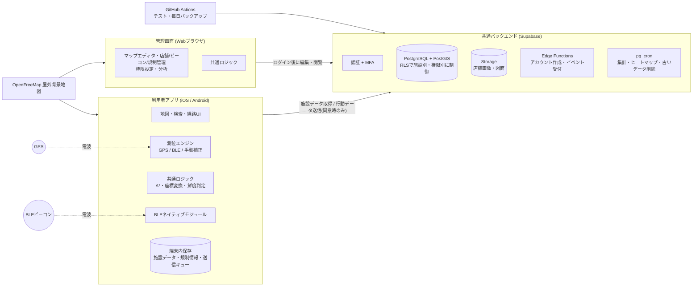
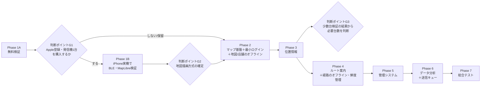

# 施設型マップ・屋内ナビゲーションアプリ 設計提案書 v1.0（再レビュー待ち）

- 対象：初期PoC開発仕様書 v1.0 ＋ 依頼者回答（v0.1への確認事項）
- 作成：Claude Code（メイン開発担当）
- 更新日：2026-11-15
- ステータス：**再レビュー待ち。本格実装はまだ開始しません**
- レビュー依頼先：ChatGPT（設計・品質確認）、Gemini（技術調査・追加レビュー）
- 前版：v0.1（Gitの履歴に保存されています）

> 表記ルール
> - 【確定】仕様書または依頼者回答で決まった事項
> - 【提案】Claude Code からの提案。承認・却下・修正をお願いします
> - 【要判断】依頼者の判断が必要な事項（費用が発生するものなど）
> - 【要検証】Phase 1 の技術検証で実際に確認してから確定する事項
> - 料金・無料枠の数値は 2026年11月時点の公開情報に基づく**概算**です。有料契約の前に必ず公式ページで再確認します（1米ドル＝約150円で換算）。

---

## v0.1 からの主な変更点

| # | 変更内容 | 該当章 |
|---|---|---|
| 1 | 質問 Q1〜Q14 の回答を反映 | 全体、付録A |
| 2 | **オフライン対応を初期PoCの必須機能に格上げ**（マップ・店舗・検索・経路・測位・行動データの一時保存・重複防止・規制情報の鮮度管理） | 第4章 |
| 3 | **同意・権限を3つに分離**（位置情報 / BLE / 分析データ送信）。分析を拒否してもナビは使える | 第5章 |
| 4 | **Windows＋iPhoneのみ**という前提での開発・検証方法を整理。Androidはエミュレーターで確認できる範囲と実機が必要な項目に分けた | 第7章 |
| 5 | BLE測位を「採用候補」とし、少数台での先行検証→必要台数の判断、という段階方式に変更。電池残量と最終検出日時を別管理 | 第6章 |
| 6 | 施設・図面が未定でも進められる計画に変更（サンプル施設、図面なしでのマップ作成方法） | 第3章、第10章 |
| 7 | Phase 1 を「1A：無料で検証」と「1B：Apple登録が必要な検証」に分け、間に判断ポイントを設けた | 第10章 |
| 8 | 「PoCで実装 / 将来対応」「無料 / 有料」の一覧を明確化 | 第2章、第9章 |

---

## 目次

1. 要件の整理
2. 初期PoCで実装する機能／将来対応に回す機能
3. マップ作成方式（図面あり・なし）
4. オフライン対応設計
5. 位置情報・BLE・分析データの同意設計
6. BLE測位の設計と課題
7. 開発環境・実機検証（Windows＋iPhone）とAndroid対応
8. 推奨技術構成
9. 費用：無料でできる範囲／有料・機材が必要な部分
10. 開発工程・判断ポイント・完成条件と検証方法
11. データベース・権限設計
12. 技術的リスク一覧
13. 依頼者に判断いただきたいこと
14. 次のステップ

付録A：質問への回答と反映先

---

## 1. 要件の整理

### 1-1. システム構成

| 構成要素 | 利用者 | 主な役割 |
|---|---|---|
| 利用者向けアプリ（iOS / Android） | 施設の来訪者 | マップ表示、店舗検索、現在地表示・補正、経路案内（オフライン対応） |
| 管理画面（Webブラウザ、PC・スマホ） | 施設管理者・サービス運営者 | マップ編集、店舗・ビーコン・経路規制管理、権限管理、分析閲覧 |
| 共通バックエンド | 両方から利用 | データ保存、認証、サーバー側の権限検証、公開データ配信、行動データの受付・集計 |

### 1-2. 前提条件【確定】

| 項目 | 内容 |
|---|---|
| 開発PC | Windows |
| テスト端末 | iPhoneのみ（Android実機なし） |
| PoC対象施設 | 未定 → 施設が決まる前でも進められる開発を先行 |
| 図面 | 未定 → 図面なしでもマップを作れる方式を用意 |
| ビーコン | 未購入 → 購入は機種・台数・費用の提案後に依頼者が判断 |
| Apple Developer Program | 未登録 → 必要時期・費用・名義を整理した上で依頼者が判断 |
| 予算方針 | 無料で進められる範囲を優先。有料サービス・機材の購入は先行しない |
| 対応言語 | 初期は日本語のみ（多言語化できる作りにはしておく） |
| 測位精度 | 暫定目標：誤差の中央値3m以内・店舗区画正答率80%。**達成は保証せず、実測で評価** |

---

## 2. 初期PoCで実装する機能／将来対応に回す機能

| 分野 | 初期PoCで実装 | 将来対応（PoCでは設計・データ構造のみ） |
|---|---|---|
| 施設・フロア | 1施設・1フロア（DBと権限は最初から複数施設・複数フロア対応） | 複数施設の本番運用、多フロアの画面操作 |
| マップ作成 | 管理画面で壁・通路・区画・出入口・設備を描画・編集 | 画像からの自動ベクター化、iPhone LiDAR等による空間スキャン |
| 図面取込 | PNG/JPEG/PDFを下敷きにしてなぞり描き、DXFの線を壁候補として取込 | DWG直接読込（PoCでは無料ツールでDXFへ変換）、IFC（BIM）、IMDF取込 |
| マップ履歴 | 下書き→公開、公開版の保存、過去の版の復元 | 版どうしの差分表示 |
| 店舗情報 | 名称・画像・カテゴリ・営業時間・説明・所在地・詳細ページ・検索 | クーポン・お知らせ、多言語 |
| **オフライン** | **マップ・店舗・施設情報・検索・経路案内・測位・手動補正・行動データの一時保存と再送・重複防止・規制情報の鮮度表示と警告** | 屋外背景地図の広域オフライン保存 |
| 屋外測位 | GPS取得・表示、屋内外の自動切替 | 施設までの屋外経路案内 |
| 屋内測位 | BLEビーコン複数台による推定・平滑化・通路への補正・精度円表示 | 歩数・向きセンサーとの組合せ（PDR）、電波指紋方式、補正データからの自動学習 |
| 現在地補正 | 更新ボタン→確認→はい/いいえ→地図タップ指定、自動と手動を区別して記録 | 補正データによる精度の自動改善 |
| 経路案内 | A*による自動探索、通行禁止・一方通行・一時封鎖・立入制限・推奨ルート | 多フロア経路の画面操作（データとアルゴリズムは対応済みにする） |
| バリアフリー | **経路データに段差・幅・エレベーター等の属性を持てる設計のみ**【確定：Q13】 | 車いす・ベビーカー向け経路案内 |
| 行動データ | 仕様書8章の全項目、集計、ヒートマップ（時間帯・店舗周辺・通路・エリア別）、生データ90日 | 機械学習による分析、外部BIツール連携 |
| 管理画面 | ログイン、最上位管理者のMFA、機能別ON/OFF権限（route.manage含む）、施設単位の分離、変更履歴・操作ログ | SSO、会社単位の階層管理 |
| 配布 | iPhone：開発ビルド／TestFlight（Apple登録後）、Android：エミュレーター確認 | App Store / Google Play 一般公開、Android実機の本格検証 |

---

## 3. マップ作成方式（図面あり・なし）

### 3-1. 対応ファイル形式

| 形式 | PoC対応 | 取込方法 | 編集可能データへの変換 |
|---|---|---|---|
| PNG / JPEG | ◎ 対応 | 下敷きとして表示し、2点＋実寸距離で縮尺合わせ・回転 | 下敷きの上をなぞって壁・区画・通路を描く（手作業） |
| PDF | ◎ 対応 | 指定ページをブラウザ内で画像化（pdf.js）→以下PNGと同じ | 同上 |
| DXF（CADの交換形式） | ○ 対応 | 線・ポリラインを読込み、レイヤーごとに表示/非表示 | 選んだレイヤーの線を「壁候補」として取込み、人が確認・修正 |
| DWG（AutoCAD形式） | △ 変換して対応 | 無料の「ODA File Converter」でDXFに変換してから取込（手順書を用意） | DXFと同じ |
| SVG | △ 将来 | ― | ― |
| IMDF（Apple屋内地図形式）/ GeoJSON | △ 将来 | 構造化された屋内地図データのため、将来は直接取込が可能 | 自動 |
| IFC（BIM） | × 将来 | ― | ― |

**画像からの壁・店舗の完全自動認識はPoCでは行いません。** 図面の描き方が施設ごとに異なり、精度を保証できないためです（将来「下書き自動生成→人が修正」を検討）。

### 3-2. 図面がない場合のマップ作成方法

| 方法 | 内容 | 費用 | 向いている場面 |
|---|---|---|---|
| A. 方眼の上で直接描く | 管理画面の方眼（1マス＝1m等）の上に、実測した寸法で壁・区画を描く | 0円（メジャーで計測。任意でレーザー距離計 約3,000〜5,000円） | 小規模なフロア、検証用のサンプル施設 |
| B. 案内板・フロアガイドの写真をなぞる | 施設の案内図やパンフレットを撮影→下敷き→実測した2点で縮尺合わせ→なぞる | 0円 | 図面はないが案内図がある施設 |
| C. 建物の外形を地図から取る | 屋外地図（OpenStreetMap）の建物輪郭を外枠として利用し、内部を A/B で描く | 0円 | 屋外地図との位置合わせを正確にしたい場合 |
| D. 手書きスケッチ＋実測 | 紙にスケッチして撮影→下敷き→主要な寸法を実測して補正 | 0円 | 案内図もない場合 |

### 3-3. 施設未定の間の進め方【提案】

- **「【サンプル】テスト施設」**（依頼者のご自宅・事務所の一室、または架空の小さなフロア）を方法Aで作成し、開発・テストに使います。
- サンプルであることは名前とDB上の印（`is_sample = true`）の両方で明示し、実データと混同させません。
- 施設が決まったら、同じ管理画面で本物のマップを作成します（作り直しの開発は不要）。

---

## 4. オフライン対応設計【確定：初期PoCで実装】

### 4-1. 基本方針

アプリが使うデータを**「施設データ一式（バンドル）」**として端末に保存し、通信がなくても地図表示・検索・経路案内ができるようにします。経路計算・測位計算はもともと端末内で行う設計のため、通信は「最新データの取得」と「行動データの送信」にだけ使います。

```mermaid
flowchart TB
  subgraph Server["サーバー (Supabase)"]
    PUB[公開済み施設データ<br/>版番号つき]
    RULE[経路規制情報<br/>(即時反映・期限つき)]
    ING[行動データ受付<br/>event_id で重複排除]
  end
  subgraph Phone["端末 (iPhone / Android)"]
    BUNDLE[(施設データ保存領域<br/>地図・店舗・通路・ビーコン・画像)]
    RCACHE[(規制情報キャッシュ<br/>取得日時つき)]
    OUTBOX[(送信待ちキュー<br/>行動データ・補正記録)]
    APP[地図表示・検索・A*経路・測位]
  end
  PUB -- 起動時/定期的に版番号を確認し差分があれば取得 --> BUNDLE
  RULE -- 取得できたら更新 --> RCACHE
  BUNDLE --> APP
  RCACHE --> APP
  APP -- 記録 --> OUTBOX
  OUTBOX -- 通信復旧時にまとめて送信・成功分のみ削除 --> ING
```

### 4-2. オフライン対応の範囲

| 対象 | オフライン時の動作 | 実装方法 |
|---|---|---|
| 屋内マップ | 表示可能 | 公開版の地図データ（GeoJSON）を端末に保存。屋内マップは背景地図に依存せず描画 |
| 屋外背景地図 | **可能な範囲で表示**（施設周辺のみ、一度表示した範囲） | 地図エンジンのキャッシュ機能で施設周辺を保存。広域は将来対応【要検証】 |
| 店舗情報・施設情報 | 閲覧可能 | バンドルに含めて保存 |
| 店舗画像 | 保存済みなら表示、未保存なら代替画像 | 施設データ取得時に画像も端末に保存（容量上限を設定） |
| 店舗検索 | 名前・カテゴリ・読み仮名で検索可能 | 端末内の検索インデックス（ひらがな/カタカナ、全角/半角を正規化） |
| 経路案内 | 可能 | 保存済みの通路ネットワーク＋保存済み規制情報で端末内A*探索 |
| GPS測位 | 可能（屋外） | GPSは通信不要。ただし通信がないと初回の位置確定に時間がかかる場合あり |
| BLE測位 | 可能（屋内） | ビーコン台帳（設置座標）をバンドルに含めて保存 |
| 手動位置補正 | 可能 | 端末内で即時反映。補正記録は送信待ちキューへ（分析同意がある場合のみ） |
| 行動データ | 端末に一時保存し、通信復旧後に送信 | 送信待ちキュー（端末内データベース） |

### 4-3. 施設データの更新ルール

1. 起動時・アプリ復帰時・一定間隔（例：15分）で、サーバーの**公開版番号**だけを確認
2. 新しい版があれば全体をダウンロード→検証（形式チェック）→**完全に揃ってから差し替え**（途中で通信が切れても古い版で動き続ける）
3. 直前の版を1つ保持し、新しい版に問題があれば戻せる
4. 画面に「地図データ：◯月◯日 ◯時◯分 時点」を表示

### 4-4. 行動データの一時保存と重複防止

| 仕組み | 内容 |
|---|---|
| 一意なID | 端末でイベントごとにランダムな `event_id`（UUID）を発行 |
| サーバー側の重複排除 | `event_id` に一意制約を設定し、同じIDが再送されても**1件しか保存されない**（`ON CONFLICT DO NOTHING`） |
| 送信成功の確認 | サーバーが受け付けた `event_id` の一覧を返し、端末はその分だけキューから削除 |
| 再送 | 失敗時は待ち時間を徐々に延ばして再試行（例：30秒→1分→2分…最大30分） |
| 容量上限 | キューは最大件数・最大保存期間（例：5,000件・7日）を設定し、超えたら古いものから破棄 |
| 時刻 | 端末の発生時刻と、サーバーの受信時刻の両方を保存（端末時計のずれに備える） |
| 同意の撤回 | 分析データの送信同意が撤回されたら、キューの未送信データを**端末から削除** |

### 4-5. 経路規制情報の鮮度管理（古い情報で誤案内しないための設計）

通行止め・一時封鎖などの**経路規制情報**は、地図データとは別に、より短い間隔で取得します。

**(1) 規制情報の持ち方**
- 各規制には開始日時・終了日時を持たせる → オフラインでも「終了日時を過ぎた規制は自動で解除」「開始日時になった規制は自動で適用」を端末内で判断できる
- 端末は「最後に規制情報を取得できた日時」を保存

**(2) 鮮度の3段階**【提案：しきい値は施設ごとに管理画面で変更可能】

| 状態 | 条件（初期値の提案） | アプリの動作 |
|---|---|---|
| 正常 | 最終取得から15分以内 | 通常どおり案内 |
| 注意 | 15分〜6時間 | 経路を表示し、画面上部に「通行規制情報は ◯時◯分 時点のものです。現地の案内表示もご確認ください」と常時表示 |
| 制限 | 6時間超 または 施設が「イベント中（規制が頻繁に変わる）」に設定されている場合は短い時間で | 経路案内の開始前に確認ダイアログを表示（「最新の通行規制を確認できません。案内が実際と異なる可能性があります」）。施設設定により**経路案内を停止し、地図表示と店舗検索のみ**にすることも可能 |

**(3) 補足**
- 管理者が規制を設定する際、「重要度：高（安全に関わる）」を選べるようにし、重要度の高い規制がある施設では「制限」へ早く移行する設定を可能にする【提案】
- オフライン中は経路の終点付近で「現地の表示に従ってください」の案内を併記

---

## 5. 位置情報・BLE・分析データの同意設計【確定：3つに分離】

### 5-1. 3つの許可・同意

| # | 項目 | 種類 | iOS | Android | 使い道 |
|---|---|---|---|---|---|
| 1 | 位置情報の利用許可 | OSの許可 | 「アプリの使用中は許可」＋「正確な位置情報」ON | 「アプリの使用中のみ」＋「正確な位置情報」 | GPS測位、（iOSでは）BLE測位にも必要 |
| 2 | BLE測位に必要な権限 | OSの許可・設定 | **追加の許可は不要**（iBeaconは位置情報の仕組みで受信するため）。ただし端末のBluetoothがONである必要あり | Android 12以降：「付近のデバイス」許可が必要（＋1の正確な位置情報）。BluetoothとOSの位置情報設定がON | 屋内測位 |
| 3 | 行動データ・分析データの送信同意 | アプリ独自の同意 | アプリ内の同意画面・設定画面 | 同左 | 利用状況分析・ヒートマップ・測位精度改善・ビーコン稼働状況の把握 |

※iOSで「正確な位置情報」がOFFの場合、BLE測位が利用できない可能性が高いため、その場合は理由を説明して設定変更を案内します【要検証：iPhone実機で確認】。

### 5-2. 同意の状態と使える機能

| 位置情報(1) | BLE(2) | 分析送信(3) | 使える機能 |
|---|---|---|---|
| 許可 | 利用可 | 同意 | すべて |
| 許可 | 利用可 | **拒否** | **地図・検索・GPS/BLE測位・手動補正・経路案内すべて利用可能**。データ送信のみ行わない |
| 許可 | 利用不可（Bluetooth OFF等） | どちらでも | 屋外はGPS。屋内は手動で現在地を指定して経路案内 |
| 拒否 | ― | どちらでも | 地図・検索は利用可能。現在地は地図タップで手動指定、または出発地を店舗・出入口から選択して経路案内 |

**どの組み合わせでも、地図・店舗検索・経路案内（出発地の手動指定）は使えるようにします。**

### 5-3. 同意画面の流れ【提案】

1. 初回起動：アプリの説明（1画面）
2. 「現在地を使って案内します」→ OSの位置情報許可ダイアログ（使う直前に表示）
3. （Androidのみ）「屋内の現在地に必要です」→ 付近のデバイス許可
4. 「サービス改善のため、匿名の利用データを送信してもよいですか？」→ 同意する／同意しない（**初期値は「同意しない」扱い**。同意しなくても全機能を使えることを明記）
5. 設定画面からいつでも変更可能。プライバシーポリシーへのリンク

### 5-4. 送信データの扱い

- 分析同意がない場合：行動データ、位置の記録、現在地補正の記録、ビーコン検出レポートは**一切送信しない**（端末内での測位・補正には使う）
- 同意がある場合も、送るのはランダムな匿名ID（1日ごとに作り直し）と操作内容・位置のみ。氏名・電話番号・広告ID等は取得しない
- ヒートマップでは件数が少なすぎるマス（例：5件未満）は表示しない
- プライバシーポリシー案は作成しますが、公開前に専門家による法的確認を推奨します

---

## 6. BLE測位の設計と課題【確定：採用候補として段階的に検証】

### 6-1. 基本姿勢

- BLE（RSSI）による測位は**環境の影響を強く受け、精度を過信できない**技術として扱います。
- 「設置間隔5〜10m」は**暫定案**であり、実測結果で見直します。
- 暫定目標（中央値3m以内・店舗区画正答率80%）は**保証値ではなく評価基準**です。届かない場合は結果・原因・改善案（台数追加、PDR併用など）と追加費用を報告します。
- 手動補正機能と精度円の表示により、測位がずれていても利用者が困らない設計を重視します。

### 6-2. 測位の仕組み

「最も近いビーコンを現在地とする」方式だけに依存しないよう、次の段階で処理します。

```
① 受信     ：周囲のビーコンの電波強度（RSSI）を約1秒ごとに取得
② ノイズ除去：ビーコンごとに外れ値除去＋平滑化（移動中央値＋カルマンフィルタ）
③ 距離推定 ：電波の減衰モデルでおおよその距離に変換（ビーコンごとの較正値を使用）
④ 位置推定 ：強い順に3〜5台で重み付き最小二乗法。2台以下なら重み付き重心法、1台なら「付近」として低精度表示
⑤ 補正     ：推定位置を歩ける場所（通路・店舗内）に寄せる。人の歩行速度を超える移動は抑制
⑥ 信頼度   ：使用台数とばらつきから「精度の目安（半径◯m）」を計算し、地図に円で表示
```

- 方式は比較できるよう差し替え可能に作り、実測データで「最寄り方式」「重心法」「最小二乗法」を比較します。
- 実測時の生データ（RSSIの時系列）を記録する**検証モード**を用意し、計算方式の改良を後からデータで試せるようにします。

### 6-3. 段階的な検証計画

| 段階 | 内容 | 必要な機材 | 目的 |
|---|---|---|---|
| ステップ1：受信確認 | iPhoneでビーコン1台のRSSIを表示 | 発信機1台＋Apple登録 | iPhoneでの受信の挙動・更新間隔・揺らぎを把握 |
| ステップ2：少数台検証 | 発信機3〜5台を一室または廊下に設置し、間隔（5m / 7.5m / 10m）を変えて誤差を測定 | 発信機3〜5台 | 方式の比較、設置間隔と精度の関係を把握 |
| ステップ3：必要台数の判断 | ステップ2の結果から、施設面積あたりの必要台数・費用を算出して提案 | ― | 依頼者が購入台数を判断 |
| ステップ4：施設での評価 | 施設決定後、実環境で評価地点20か所程度の誤差を測定 | 判断した台数 | 暫定目標に対する実測評価 |

### 6-4. 発信機（ビーコン）の選択肢と費用【要判断：購入は提案後に判断】

| 選択肢 | 1台の目安 | 長所 | 短所 | 用途 |
|---|---|---|---|---|
| 市販BLEビーコン（iBeacon対応・技適あり） | 約2,000〜5,000円 | 電池で長期間動作、設定アプリあり、施設設置に使える | 機種により電池残量の取得可否が異なる | ステップ1〜4すべて |
| 小型マイコン基板（ESP32等）を発信機化 | 約1,000〜2,000円＋USB電源 | 安い、送信設定を自由に変えられる | 電源が必要、施設設置には不向き、**技適取得済みモジュール搭載品に限る** | ステップ1〜2の開発検証のみ |
| 手持ちの別スマホを発信機化 | 0円（端末があれば） | 費用なし | 依頼者はiPhone1台のみのため現状不可。家族等の端末を借りられれば可 | ステップ1のみ |
| Windows PCを発信機化 | 0円 | 費用なし | iBeacon形式で発信できるかは**未確認**【要検証】 | ステップ1のみ（可能な場合） |

具体的な機種名・価格・技適・電池仕様は、**ステップ1に進む判断の直前に最新情報を調査して候補表を提示**します（市場の在庫・価格が変わりやすいため）。

**選定条件（案）**：iBeacon対応 ／ 発信間隔（100〜300ms）・送信出力を設定可能 ／ 電池交換可能 ／ 技適マーク付き ／ 電池残量の通知機能は「あれば加点」（必須にしない）

**費用の目安**：
- ステップ1（受信確認）：1台 約2,000〜5,000円
- ステップ2（少数台検証）：3〜5台で 約6,000〜25,000円（ステップ1の1台を含む）
- ステップ4（施設全体）：面積と実測結果次第。参考までに5〜10m間隔なら1,000㎡で約10〜40台（約2万〜20万円）。**この数字は暫定で、ステップ2の結果で見直します**

### 6-5. 設置方法（案）

- 高さ：天井付近または床から2〜3m（人体による遮蔽を減らす）
- 配置：通路の分岐点・出入口・エレベーター前を優先し、その間を一定間隔で埋める
- 固定：両面テープまたはネジ止め（施設の許可が必要）。金属面への直付けは電波が弱まるため避ける
- 管理画面で設置位置を地図上に登録し、設置写真・設置日をメモできるようにする
- UUIDは施設ごとに1つに統一し、Major/Minor番号で個体を識別（iOSの制約への対応、第7章）

### 6-6. ビーコンの稼働管理【確定：電池残量と最終検出日時は別管理】

| 管理項目 | 取得方法 | 取得できない場合 |
|---|---|---|
| 最終検出日時 | ①分析同意済み利用者の端末からの匿名検出レポート ②管理者が専用の**点検モード**で施設内を歩いて記録 | 「未検出」として警告 |
| 電池残量 | ①電池残量を通知する機種なら点検モードで読み取り ②管理者が手入力 | 「取得不可」として扱い、**設置日・電池交換日＋想定電池寿命から交換予定日を計算して通知** |
| 状態 | 管理者が設定（有効／無効／保守中／撤去） | ― |
| 点検・交換履歴 | 管理者が記録 | ― |

- 測位側では、検出されないビーコンは自動で計算から除外し、残りで測位を続けます。
- 「最終検出日時」は利用者数が少ない施設や分析同意者が少ない場合は更新されにくいため、点検モードを併用します。

### 6-7. その他の課題と対策

| 課題 | 対策 |
|---|---|
| 電波の揺らぎ（±5〜10dBm）・人体や什器による遮蔽 | 平滑化、複数台使用、通路への補正、精度円の表示 |
| 端末差（機種ごとの受信感度の違い） | 機種別補正値を持てる設計。PoCではiPhoneのみ評価し、Androidは実機入手後 |
| 表示の遅れ | 平滑化の強さを調整可能にし、実測で決定 |
| 屋内外の切替のちらつき | 施設エリア判定＋ビーコン検出台数＋一定時間の継続条件で切替 |
| 電池消費 | 地図画面表示中のみスキャン |
| なりすまし（同じIDの電波を第三者が発信） | PoCでは対策対象外としてリスクに明記。将来、ID変化型ビーコンを検討 |
| ビーコン設置座標がアプリ内に保存される | 公開情報として扱う（測位に必須のため）。なりすましリスクと合わせて明記 |

---

## 7. 開発環境・実機検証（Windows＋iPhone）とAndroid対応

### 7-1. Windows環境で開発できる範囲

| 作業 | Windowsで可能か | 方法 |
|---|---|---|
| コードの作成・編集 | ◎ | VS Code |
| 管理画面の開発・確認 | ◎ | ブラウザで確認 |
| バックエンド（Supabase） | ◎ | Webのダッシュボード＋クラウド上の開発用プロジェクト（Docker不要） |
| 共通ロジック（経路探索・測位計算）のテスト | ◎ | 自動テスト（Vitest） |
| iPhoneで画面を確認（ネイティブ機能なし） | ◎ | **Expo Go**（無料アプリ）でQRコードを読み取る |
| iOSアプリのビルド | ○ | **EAS Build（クラウドでビルド）**。Mac不要 |
| iOSシミュレーター | × | Mac専用のため使えない（iPhone実機で代替） |
| iOSネイティブコード（Swift）のデバッグ | △ | Xcodeが使えないため、アプリ内のログ表示画面とエラー監視で代替。ネイティブ部分は最小限にする |
| Androidエミュレーター | ◎ | Android Studio（無料）。PCのメモリ16GB以上を推奨（8GBでも動作は可能だが遅い） |

### 7-2. iOSアプリのビルド方法と、iPhone実機での確認方法

iPhoneでの確認には2つの段階があります。

| 段階 | 方法 | Apple登録 | 確認できること | 確認できないこと |
|---|---|---|---|---|
| ① Expo Go | iPhoneに無料アプリ「Expo Go」を入れ、PC画面のQRコードを読む。PCとiPhoneを同じWi-Fiに接続 | **不要** | 画面・操作、屋内マップ（SVG描画）、店舗検索、オフライン保存、端末内の経路探索、**GPS**、同意画面 | **BLE測位**、**MapLibre（ネイティブ地図）**など、独自のネイティブ機能 |
| ② 開発ビルド | EAS Buildでクラウドビルド→iPhoneにインストール（端末登録・iPhoneの「デベロッパモード」ON）。以後のコード変更は再ビルドなしで即反映 | **必要** | すべての機能（BLE、MapLibre含む） | ― |

- 開発ビルドは**ネイティブ部分を変えたときだけ**作り直せばよく、通常の画面修正は再ビルド不要です。EAS無料枠（月30回程度、うちiOSは15回程度とされる【要確認】、待ち時間が長い場合あり）で足りる見込みです。
- TestFlight（Appleのテスト配布）での配布もApple登録後に可能です。

### 7-3. Apple Developer Program：必要になるタイミング・費用・名義【要判断】

| 項目 | 内容 |
|---|---|
| 必要になるタイミング | **Phase 1B（iPhoneでのBLE・MapLibre検証）の開始時**。それより前（Phase 1A）は不要 |
| 登録しない場合 | Expo Goで確認できる範囲（画面・地図(SVG)・検索・オフライン・経路・GPS・管理画面）は開発を続けられる。**BLE測位とMapLibreのiPhone確認ができないため、Phase 3のBLE部分は「未検証」のまま止まる** |
| 費用 | 年額99米ドル（現在の為替で約14,000〜15,000円。日本での正確な金額は登録画面で要確認）。毎年更新 |
| 名義：個人 | 本人確認のみで登録可能。App Storeの販売元に**個人名が表示**される |
| 名義：組織（法人） | 法人格とD-U-N-S番号（無料で取得可能、発行に数日〜数週間）が必要。販売元に法人名が表示される。**施設向けサービスとして公開するなら組織名義が望ましい** |
| 判断の目安（提案） | 開発・検証のみの段階は個人名義で登録し、一般公開の前に組織名義へ移行（または組織名義で登録し直し）。個人→組織の移行手続きの可否・条件はAppleへの事前確認が必要【要確認】 |

### 7-4. BLE測位を検証するために必要な環境

| 必要なもの | 状況 | 費用 |
|---|---|---|
| iPhone（Bluetooth・位置情報ON） | あり | 0円 |
| Apple Developer Program 登録 | 要判断 | 年額 約1.4〜1.5万円 |
| EAS Build（開発ビルド） | 無料枠で可 | 0円 |
| BLE発信機 1台（ステップ1）→ 3〜5台（ステップ2） | 要判断 | 約2,000円〜25,000円 |
| 検証場所（サンプル施設） | ご自宅・事務所等 | 0円 |
| メジャー（評価地点の座標計測） | ― | 0円〜（任意でレーザー距離計 約3,000〜5,000円） |

### 7-5. Android版の検証方法と時期

| 検証項目 | エミュレーター（Windows・無料）で確認可能 | 実機が必要 |
|---|---|---|
| 画面表示・操作・レイアウト | ◎ | 一部の機種固有の表示崩れ |
| MapLibreによる地図表示 | ◎（開発ビルドをエミュレーターに入れて確認） | 描画性能 |
| 店舗検索・オフライン保存・経路探索 | ◎ | ― |
| 同意画面・権限ダイアログの流れ | ◎ | 機種ごとの設定画面の違い |
| GPS | ○（擬似的な位置を設定して確認） | 実際の受信精度 |
| **BLE測位** | **×**（エミュレーターでは実際のビーコン電波を受信できない） | **必須** |
| 省電力機能による動作停止 | × | 必須（メーカーごとに挙動が違う） |
| 性能・電池消費 | × | 必須 |

**時期と方法（提案）**
- Phase 1A〜6：Android向けの機能は毎Phaseでエミュレーター確認（無料）。Android用の開発ビルドはEASまたはPC上で作成（Apple登録不要）
- **Android実機でのBLE検証は、一般公開を判断する前（Phase 7）に実施**。実機は「中古端末の購入（約1〜2万円）」「知人から借用」のいずれかを、その時点で依頼者が判断
- それまでAndroidのBLE測位は報告上「🟡 仮実装（実機未検証）」と明記
- Google Playへの配布登録（25米ドル・1回のみ）はAndroid配布を行う段階まで不要

### 7-6. 実機での確認作業について

Claude Codeは依頼者のiPhoneを直接操作できません。実機確認は依頼者にお願いすることになるため、毎回「どのボタンを押し、何が表示されれば成功か」を書いた手順書を用意し、結果（スクリーンショット・画面のログ）を共有していただく流れにします。

---

## 8. 推奨技術構成

### 8-1. 採用技術【確定：Phase 1で検証し、問題があれば代替案を提示】

| 区分 | 採用技術 | 代替案（Phase 1で問題があった場合） |
|---|---|---|
| 言語 | TypeScript（全体共通） | ― |
| 利用者アプリ | React Native + Expo | （大きな問題があればFlutterを再検討。ただしBLEのネイティブ実装が必要な点は同じ） |
| 屋内マップ描画 | **描画部分を差し替え可能な設計**にし、MapLibre React Native を第一候補とする | react-native-svg / Skia による独自描画（Expo Goでも動くため、Apple登録前から開発可能） |
| 屋外背景地図 | OpenFreeMap（無料・キー不要） | MapTiler無料枠、Protomaps（地図ファイルを自前配信） |
| BLE測位 | 自作ネイティブモジュール（iOS：Swift / CoreLocation、Android：Kotlin / BLEスキャン） | ― |
| 端末内保存（オフライン） | expo-sqlite（送信キュー・検索）、expo-file-system（施設データ・画像） | ― |
| 管理画面 | React + Vite、MapLibre GL JS、Terra Draw（図形編集）、pdf.js、dxf-parser | ― |
| 共通ロジック | TypeScriptパッケージ（A*経路探索、測位計算、座標変換、規制情報の鮮度判定、データ型） | ― |
| バックエンド | Supabase（PostgreSQL + PostGIS、Auth＋MFA、Storage、Edge Functions、pg_cron） | 中身は標準PostgreSQLのため、他クラウドや自前サーバーへ移行可能 |
| 管理画面の公開 | Cloudflare Pages（無料枠で商用利用可） | Netlify |
| ビルド・配布 | EAS Build / EAS Update、TestFlight | ― |
| テスト | Vitest（ロジック）、pgTAP（DB権限）、Playwright（管理画面） | ― |
| ソース管理・CI | Git + GitHub、GitHub Actions | ― |
| エラー監視 | Sentry（無料枠） | ― |

### 8-2. 採用理由（要約）

- **TypeScriptで統一**：経路探索・測位計算・鮮度判定を1つのコードでアプリと管理画面に使え、テストも1か所で済む
- **Expo**：MacなしでiOSビルドができる（Windows環境の条件に合う）。Apple登録前でもExpo Goで多くの開発・確認ができる
- **Supabase**：認証・DB・権限（RLS）が揃い、無料で始められ、中身が標準PostgreSQLのため商用化・移行に耐える
- **MapLibre**：無料・商用可で、屋外地図と屋内地図を同じ画面に表示できる

### 8-3. 座標の持ち方

マップ図形・ビーコン位置は**施設ごとのローカル座標（メートル単位のx, y）＋フロア**で保存し、施設ごとに原点の緯度経度・回転角を持ちます。図面・実測値をそのまま使え、測位・経路計算が単純になり、GPS精度に左右されません。

### 8-4. システム構成図



### 8-5. フォルダ構成（予定）

```
/
├── apps/
│   ├── mobile/                      利用者アプリ（Expo）
│   │   └── modules/beacon-scanner/  BLE測位ネイティブモジュール
│   └── admin/                       管理画面（React + Vite）
├── packages/
│   ├── core/                        共通ロジック＋単体テスト
│   └── shared-types/                DBの型定義（自動生成）
├── supabase/
│   ├── migrations/                  DB定義の変更履歴（SQL）
│   ├── tests/                       権限テスト（pgTAP）
│   ├── functions/                   Edge Functions
│   └── seed/                        【サンプル】データ
├── docs/                            設計書・API仕様・手順書・マニュアル・テスト結果
└── .github/workflows/               自動テスト・バックアップ
```

---

## 9. 費用：無料でできる範囲／有料・機材が必要な部分

### 9-1. 無料で実装・検証できる範囲

| 範囲 | 内容 |
|---|---|
| 開発環境 | Windows上の開発環境一式（Node.js、Git、VS Code、Android Studio） |
| 管理画面 | 全機能（ログイン、MFA、マップ編集、図面取込、店舗・ビーコン・規制管理、権限、分析、ヒートマップ） |
| バックエンド | Supabase無料枠での全機能（DB 500MB、ファイル1GB、プロジェクト2つ） |
| 利用者アプリ（iPhone・Expo Go） | 画面、屋内マップ（SVG描画）、店舗情報・検索、オフライン保存、経路案内、GPS測位、手動補正、同意画面、行動データの一時保存・送信 |
| 利用者アプリ（Androidエミュレーター） | 上記＋MapLibre表示の確認 |
| 共通ロジック | 経路探索・測位計算（記録済みデータや模擬データでの検証）・鮮度判定の自動テスト |
| サンプル施設のマップ作成 | 図面なしの方法A〜D |
| バックアップ | GitHub Actionsで毎日自動書き出し（保存先：Cloudflare R2 無料枠、暗号化） |

### 9-2. 有料サービス・機材が必要な部分

| 項目 | 費用（概算） | 必要になる時期 | 必要な理由 | なしで進めた場合 |
|---|---|---|---|---|
| Apple Developer Program | 年額99米ドル（約1.4〜1.5万円） | Phase 1B | iPhoneでBLE・MapLibreを確認するための開発ビルドに必要 | BLE測位・MapLibreのiPhone確認ができない |
| BLE発信機（受信確認用 1台） | 約2,000〜5,000円 | Phase 1B | iPhoneでの受信挙動確認 | 同上 |
| BLE発信機（少数台検証 3〜5台） | 合計 約6,000〜25,000円 | Phase 3 | 測位方式・設置間隔の検証 | 測位精度の評価ができない |
| BLEビーコン（施設設置分） | 施設面積と検証結果次第（例：1,000㎡で約2万〜20万円） | 施設決定後 | 施設での実測評価 | 施設での評価ができない |
| Android実機（中古） | 約1〜2万円（借用なら0円） | Phase 7 | AndroidでのBLE・省電力・性能の確認 | AndroidのBLEは「実機未検証」のまま |
| Google Play デベロッパー登録 | 25米ドル（約3,750円・1回のみ） | Android配布時 | Google Playでの配布 | Android版を配布できない |
| レーザー距離計（任意） | 約3,000〜5,000円 | 任意 | 図面なしでのマップ作成・評価地点計測の効率化 | メジャーで代替可 |
| Supabase Pro | 月額25米ドル〜（約3,750円〜） | **商用サービス開始前** | 自動バックアップ、停止なし、容量拡大 | 無料枠のまま（1週間アクセスなしで一時停止、自動バックアップなし） |
| 独自ドメイン（任意） | 年額 約1,500〜3,000円 | 任意 | 管理画面のURLを独自にする | 無料のサブドメインで可 |
| クラウドMacのレンタル（任意） | 利用時間に応じて課金 | iOSネイティブ部分の不具合が解決できない場合のみ | Xcodeによるデバッグ | 通常は不要の見込み |

### 9-3. 費用の段階まとめ

| 段階 | 主な支出 | 合計目安 |
|---|---|---|
| Phase 1A（無料検証） | なし | **0円** |
| Phase 1B（iPhone実機でBLE・MapLibre検証） | Apple登録＋発信機1台 | **約1.6〜2万円** |
| Phase 3（少数台検証） | 発信機を3〜5台に追加 | 追加 約4,000〜20,000円 |
| 施設決定後 | 施設設置分のビーコン | 実測結果をもとに別途見積 |
| 一般公開前 | Android実機（任意）・Google Play登録・Supabase Pro | 初期 約1.4〜2.4万円＋月額 約3,750円〜 |

### 9-4. 無料枠の注意点

- Supabase無料枠は**1週間アクセスがないと一時停止**します（データは消えず、ダッシュボードから再開可能）。開発期間中は定期的な自動アクセスで回避します。
- 無料枠のDB容量（500MB）を超えると読み取り専用になります。Phase 1Aで【サンプル】行動データを大量に作り、どの程度の利用規模まで無料枠に収まるかを実測します。
- EAS Buildの無料枠は月30回程度・待ち時間ありとされます（iOS分の上限は要確認）。

---

## 10. 開発工程・判断ポイント・完成条件と検証方法

### 10-1. 工程表



| Phase | 内容 | 費用 | 期間目安※ |
|---|---|---|---|
| 1A | Windows開発環境、リポジトリ、Supabase、Expo Go確認、オフライン・経路の試作、無料枠の実測 | 0円 | 1〜2週間 |
| 1B | iPhone開発ビルド、MapLibre iOS確認、BLE受信確認（ステップ1） | 約1.6〜2万円 | 1週間 |
| 2 | マップ基盤、最小ログイン（最上位管理者）、地図・店舗のオフライン | 0円 | 3〜4週間 |
| 3 | GPS、BLE測位、現在地補正、少数台検証（ステップ2） | 発信機追加分 | 3〜4週間 |
| 4 | 通路ネットワーク、A*、管理者指定経路、経路のオフライン、規制情報の鮮度管理 | 0円 | 2〜3週間 |
| 5 | アカウント管理、機能別ON/OFF権限、施設管理、MFA | 0円 | 2週間 |
| 6 | 行動データ、送信キュー・重複防止、集計、ヒートマップ | 0円 | 2週間 |
| 7 | 総合テスト（iPhone実機、Androidエミュレーター／実機、管理画面、セキュリティ、復旧試験） | Android実機は任意 | 2〜3週間 |

※依頼者の確認作業の時間、判断ポイントでの決定時期、施設決定時期により大きく変わります。合計 約4〜5か月が目安です。
※**施設での実測評価（BLEステップ4）は施設決定後に行い**、PoCの他の工程とは独立して進めます。

### 10-2. 判断ポイント

| ID | 時期 | 判断内容 | Claude Codeが提出する材料 |
|---|---|---|---|
| G1 | Phase 1A完了時 | Apple Developer登録（名義含む）と発信機1台の購入をするか | 1Aの検証結果、発信機の機種候補表（価格・技適・電池仕様）、登録手順 |
| G2 | Phase 1B完了時（G1保留ならPhase 2開始時） | 地図描画をMapLibreにするか独自描画にするか | iOS/Androidでの表示・性能比較、問題点と代替案 |
| G3 | Phase 3のステップ2完了時 | BLE測位を本採用するか、施設用に何台必要か | 実測誤差の表とグラフ、方式比較、設置間隔別の精度、台数・費用見積 |
| G4 | Phase 7開始時 | Android実機を用意するか、Google Play登録をするか | エミュレーターでの確認結果、実機未検証項目の一覧 |

技術的な問題が見つかった場合は、その時点で実装を止め、**問題点・代替案・追加費用**を報告して判断をいただきます。

### 10-3. 各Phaseの完成条件と検証方法

検証方法の記号：**[自動]** 自動テスト ／ **[画面]** ブラウザやExpo Goでの手動確認 ／ **[実機]** iPhone開発ビルドでの確認 ／ **[エミュ]** Androidエミュレーター ／ **[計測]** 実測・記録

#### Phase 1A：設計・環境構築・無料検証

| 完成条件 | 検証方法 |
|---|---|
| 依頼者のWindows PCにNode.js・Git・VS Codeが入り、手順書どおりに開発環境を起動できる | [画面] 依頼者が手順書に沿って実施し、スクリーンショットで確認 |
| リポジトリにフォルダ構成・README・自動テストの仕組みがあり、GitHub上でテストが自動実行され成功する | [自動] GitHub Actions |
| Supabase開発用プロジェクトに最初のDB定義（施設・フロア・権限の土台）が適用されている | [自動] DB定義の適用テスト |
| iPhoneのExpo Goでサンプル施設の屋内マップ（SVG描画）が表示される | [画面] 依頼者のiPhone |
| 施設データをダウンロード→機内モードにしても地図表示・店舗検索・経路表示ができる（試作） | [画面] iPhoneで機内モード切替 |
| 端末内のA*経路探索が壁を通らない経路を返す | [自動] 単体テスト |
| 送信キューの重複防止（同じイベントを2回送っても1件）を確認 | [自動] DBテスト |
| Androidエミュレーターの開発ビルドでMapLibreにサンプル図形が表示される | [エミュ] |
| 【サンプル】行動データを大量投入し、無料枠でどの程度の利用規模まで耐えるかを試算 | [計測] 結果を表で報告 |
| G1の判断材料（発信機候補表、Apple登録の手順と名義の比較）を提出 | 文書 |

#### Phase 1B：iPhone実機検証（G1で承認された場合）

| 完成条件 | 検証方法 |
|---|---|
| EAS BuildでiOS開発ビルドを作成し、依頼者のiPhoneにインストールできる | [実機] |
| iPhoneでMapLibreによる屋内マップが表示・拡大縮小できる | [実機] |
| iPhoneで発信機1台のRSSIが約1秒ごとに画面に表示される | [実機] |
| 静止時・移動時・手で遮った時のRSSIの揺らぎを記録 | [計測] グラフで報告 |
| 「正確な位置情報」OFF時・Bluetooth OFF時の挙動を確認 | [実機] |
| G2の判断材料を提出 | 文書 |

#### Phase 2：マップ基盤

| 完成条件 | 検証方法 |
|---|---|
| 最上位管理者でログインでき、未ログインでは管理画面に入れない | [画面] [自動] |
| 未ログインの通信から下書きデータ・編集機能にアクセスできない | [自動] 権限テスト |
| 壁・通路・店舗区画・出入口・エレベーター・階段・トイレを描画・移動・削除できる | [画面] [自動] Playwright |
| 方眼の上での作図、PNG/JPEG/PDFの下敷きと縮尺合わせ、DXFの線の取込ができる | [画面] サンプル図面で確認 |
| 店舗の登録・編集・非表示・削除・アイコン変更・区画変更ができる | [画面] [自動] |
| 「公開」すると利用者アプリに反映され、過去の版に戻すと元に戻る | [画面] |
| 利用者アプリで地図表示・店舗タップで情報表示・詳細ページ・名前/カテゴリ/読み仮名検索ができる | [画面] [実機] [エミュ] |
| **オフライン**：機内モードで地図・店舗情報・画像（保存済み）・検索が使え、「地図データ：◯時点」が表示される | [画面] [実機] |
| **オフライン**：データ更新の途中で通信が切れても古い版で動き続ける | [自動] [画面] |

#### Phase 3：位置情報

| 完成条件 | 検証方法 |
|---|---|
| 屋外でGPS現在地と精度円が表示される | [画面] Expo GoでもOK |
| 屋内でBLEにより現在地と精度円が表示される | [実機] |
| 屋内外の切替が入口付近でちらつかない | [実機] |
| 現在地更新ボタン→確認→「はい」で採用／「いいえ」で地図タップ指定、が動く | [画面] [実機] |
| 自動測位と手動補正が区別して記録される（分析同意時のみ送信、非同意時は送信されない） | [自動] [画面] |
| オフラインでもGPS・BLE測位・手動補正が使える | [実機] 機内モード（Bluetooth・位置情報はON） |
| 発信機を1台止めても測位が続く | [実機] |
| ビーコン台帳で、最終検出日時と電池残量（取得不可を含む）が別々に表示され、交換予定日が計算される | [画面] [自動] |
| 管理者の点検モードで検出記録ができる | [実機] |
| 少数台検証（ステップ2）の誤差・方式比較・設置間隔別の結果を提出（G3の材料） | [計測] 表・グラフ・考察 |
| Android向けBLE処理はエミュレーターで動作確認できる範囲のみ確認し「実機未検証」と明記 | [エミュ] |

#### Phase 4：ルート案内

| 完成条件 | 検証方法 |
|---|---|
| 管理画面で通路ネットワークを描け、壁と交差する線は警告される | [画面] [自動] |
| 現在地（または手動で選んだ出発地）から店舗までの最短経路が表示される | [画面] [実機] |
| 通行禁止・一方通行・一時封鎖（期間指定）・立入制限・推奨ルートが経路に反映され、公開操作なしで反映される | [自動] [画面] |
| 経路が見つからない場合に適切なメッセージが出る | [自動] [画面] |
| 壁を通らない・逆走しない・封鎖を通らない・多フロアのテストデータでも動くことの自動テストが通る | [自動] |
| 段差・幅などのバリアフリー属性を通路データに保存できる（案内機能は将来） | [自動] |
| **オフライン**：機内モードで経路案内ができる | [画面] [実機] |
| **オフライン**：期限の切れた規制は端末内で自動解除、開始時刻の来た規制は自動適用される | [自動] |
| **鮮度管理**：「正常／注意／制限」が時間経過で切り替わり、表示・確認ダイアログ・案内停止（施設設定時）が動く | [自動]（時刻を模擬）[画面] |

#### Phase 5：管理システム

| 完成条件 | 検証方法 |
|---|---|
| 最上位管理者がアカウントを作成・停止できる | [画面] [自動] |
| 最上位管理者はMFA（ワンタイムコード）なしでは特権操作ができない | [自動] [画面] |
| 施設ごとに機能別ON/OFFスイッチ（route.manage含む11種）で権限を設定できる | [画面] |
| 権限OFFの機能は画面に表示されず、**かつ直接API/DBを呼んでも拒否される**（全権限×全操作） | [自動] 権限テスト |
| 施設Aの管理者が施設Bのデータを閲覧・編集できない | [自動] |
| 一般アカウントが最上位管理者権限を付与できない／自分にない権限を付与できない／自分の権限を変更できない | [自動] |
| 権限変更履歴・操作ログを管理画面で確認でき、ログは改ざんできない | [画面] [自動] |
| 施設情報・フロア情報・鮮度しきい値の設定ができる | [画面] |
| 管理画面がスマホのブラウザでも操作できる | [画面] iPhoneのSafari |

#### Phase 6：データ分析

| 完成条件 | 検証方法 |
|---|---|
| 位置情報・BLE・分析送信の3つが別々に許可/拒否でき、分析を拒否してもナビが全機能使える | [画面] [実機] |
| 分析拒否時は一切送信されない／同意撤回時に未送信データが端末から削除される | [自動] [画面] |
| 仕様書8章の全項目が記録される | [自動] |
| オフライン中のデータが端末に保存され、通信復旧後に送信される | [画面] 機内モード切替 |
| 送信途中で通信が切れて再送しても重複しない | [自動] |
| 管理画面で期間・時間帯別のグラフ、ヒートマップ（時間帯・店舗周辺・通路・エリア別）が見られる | [画面]（【サンプル】データで確認し、サンプルと明記） |
| 少数件のマスが表示されない | [自動] |
| 生データの90日後自動削除と定期集計が動く | [自動] |

#### Phase 7：総合テスト

| 完成条件 | 検証方法 |
|---|---|
| iPhone実機でのテスト項目表をすべて実施し結果を記録 | [実機] |
| Androidエミュレーターでのテスト項目表を実施。実機項目はG4の判断に従い実施または「未検証」と明記 | [エミュ]（実機） |
| 管理画面をPC（Chrome/Edge）とiPhone（Safari）で確認 | [画面] |
| セキュリティ確認（権限テスト、秘密鍵の混入チェック、依存ライブラリの脆弱性チェック） | [自動] |
| バックアップからの復旧を実際に試験し手順書化 | [計測] |
| 施設決定済みの場合は施設でのBLE評価（ステップ4）結果を提出、未決定の場合は未実施と明記 | [計測] |
| 成果物（仕様書14章）が揃っている | 文書チェック |

### 10-4. 実装状況の表記ルール

各Phaseの報告で、全機能を次の区分で一覧表示します。

| 表記 | 意味 |
|---|---|
| ✅ 実装済み | 動作確認・テスト済み |
| 🟡 仮実装 | 動くが制約あり（例：サンプルデータで確認、Android実機未検証）。制約を必ず併記 |
| ⬜ 未実装 | まだ作っていない |
| ⏸ 保留 | 判断待ち・機材待ち（例：Apple登録待ち） |
| ❌ 実装不可・代替 | 理由と代替案を併記 |

### 10-5. 作業の進め方（AI分担）

1. Claude Code がPhaseごとに作業ブランチで実装し、変更内容の説明と確認手順を書く
2. 依頼者が説明と差分を ChatGPT・Gemini に渡してレビューを依頼
3. 指摘を Claude Code に伝えていただき修正
4. 依頼者が手順書どおりに画面・実機で確認
5. 承認後に統合（Gitに記録）

---

## 11. データベース・権限設計

### 11-1. 基本方針

1. すべてのデータに `facility_id` を持たせ、施設をまたいだアクセスをDB（RLS）で遮断
2. 権限チェックはDBで強制し、画面のボタン非表示は補助に過ぎない扱いとする
3. 利用者アプリはログイン不要。読めるのは公開済みデータ、書けるのは行動イベントの追加のみ
4. マップは下書きと公開版を分離し、公開ごとに版を保存
5. 重要テーブルの変更はトリガーで操作ログに自動記録

### 11-2. 主要テーブル

**施設・マップ系**

| テーブル | 主な項目 | 説明 |
|---|---|---|
| facilities | id, name, slug, status, is_sample, origin_lat, origin_lng, rotation_deg, boundary, rule_fresh_minutes, rule_restrict_minutes, restrict_mode(確認のみ/案内停止), event_mode | 施設。鮮度しきい値もここで管理 |
| floors | id, facility_id, level, name, sort_order | フロア |
| map_features | id, facility_id, floor_id, kind, geometry, properties, store_id | 地図要素（下書き） |
| map_versions | id, facility_id, version_no, snapshot(JSON), status, note, published_by, published_at | 公開版（端末に配布するバンドルの元） |
| floor_plan_imports | id, facility_id, floor_id, file_path, file_type, scale, offset, rotation | 取込図面と位置合わせ情報 |

**店舗系**

| テーブル | 主な項目 |
|---|---|
| store_categories | id, facility_id, name, icon, sort_order |
| stores | id, facility_id, floor_id, category_id, name, name_kana, description, image_path, icon, opening_hours(JSON), is_visible, detail(JSON) |

**経路系**

| テーブル | 主な項目 | 説明 |
|---|---|---|
| nav_nodes | id, facility_id, floor_id, x, y, kind, store_id | 通路ネットワークの点 |
| nav_edges | id, facility_id, from_node, to_node, direction, cost_factor, is_vertical, **has_steps, width_m, slope, accessible**(バリアフリー属性。案内機能は将来) | 通路ネットワークの線 |
| route_rules | id, facility_id, kind(通行禁止/一時封鎖/立入制限/推奨ルート), severity(通常/高), target_edges, target_area, starts_at, ends_at, is_active, updated_at | 経路規制。即時反映・期限つき |

**測位系**

| テーブル | 主な項目 | 説明 |
|---|---|---|
| beacons | id, facility_id, floor_id, uuid, major, minor, x, y, z, tx_power, status, installed_at, note | ビーコン台帳 |
| beacon_health | beacon_id, **last_seen_at, last_seen_source**(利用者レポート/点検モード), **battery_level(NULL可), battery_reported_at, battery_source**(機器通知/手入力/取得不可), battery_replaced_at, expected_battery_months | **最終検出と電池残量を別々に管理** |
| beacon_maintenance_logs | id, beacon_id, action(点検/電池交換/移設/撤去), note, actor_id, created_at | 点検・交換履歴 |
| position_corrections | id, event_id, facility_id, floor_id, anon_session_id, source(GPS/BLE自動/手動確認/手動補正), est_x, est_y, corrected_x, corrected_y, accuracy_m, beacon_snapshot(JSON), device_model, occurred_at, received_at | 現在地補正記録（同意時のみ） |
| positioning_test_runs | id, facility_id, point_id, true_x, true_y, method, samples(JSON), created_at | 精度評価用の検証記録 |

**行動データ系**

| テーブル | 主な項目 | 説明 |
|---|---|---|
| analytics_events | **event_id(一意)**, facility_id, anon_session_id, event_type, floor_id, x, y, payload, platform, app_version, **occurred_at, received_at** | 生イベント。90日で削除 |
| analytics_hourly | facility_id, date, hour, event_type, target_id, count | 時間帯別集計 |
| heatmap_cells | facility_id, floor_id, date, hour, cell_x, cell_y, count | ヒートマップ |
| search_keywords_daily | facility_id, date, keyword, count | 検索キーワード集計 |

**アカウント・権限系**

| テーブル | 主な項目 | 説明 |
|---|---|---|
| profiles | id, display_name, is_super_admin, is_active | 管理画面アカウント |
| permissions | key, label, description, category | 権限マスタ |
| facility_members | user_id, facility_id, created_by | 所属施設 |
| user_permissions | user_id, facility_id, permission_key, granted_by, granted_at | 行あり＝ON、なし＝OFF |
| permission_audit_log | id, actor_id, target_user_id, facility_id, permission_key, action, created_at | 権限変更履歴（変更・削除不可） |
| audit_log | id, actor_id, facility_id, table_name, record_id, action, before, after, created_at | 操作ログ（自動記録） |

### 11-3. 権限一覧（ON/OFFスイッチ）

| キー | 表示名 | 内容 |
|---|---|---|
| map.view | マップ閲覧 | 下書き・履歴の閲覧 |
| map.edit | マップ編集 | 図形編集・公開・復元・図面取込 |
| route.manage | 経路規制管理【確定：Q10】 | 通行禁止・一時封鎖・立入制限・推奨ルート・鮮度しきい値 |
| store.view | 店舗情報閲覧 | |
| store.edit | 店舗情報編集 | 登録・編集・非表示・削除 |
| beacon.manage | ビーコン管理 | 台帳・稼働状況・点検記録 |
| userdata.view | 利用者データ閲覧 | 生データ（補正記録・イベント明細） |
| analytics.view | 分析データ閲覧 | 集計・ヒートマップ |
| account.manage | アカウント管理 | 自施設アカウントの作成・停止 |
| permission.grant | 権限付与 | 自施設アカウントの権限ON/OFF |
| facility.edit | 施設情報編集 | 施設名・フロア・位置合わせ |

最上位管理者は上記すべてを全施設で持ち、加えて施設の新規作成・最上位管理者の任命/解除・システム設定ができます。

### 11-4. 権限の安全ルール（サーバー側で強制）

1. 最上位管理者フラグは最上位管理者しか変更できない（一般アカウント用の経路を作らない）
2. 一般アカウントは自分が持っている権限しか他人に付与できない
3. 自分自身の権限は変更できない（最上位管理者を除く）
4. 他施設のアカウント・データにはアクセスできない
5. 最後の最上位管理者は削除・降格できない
6. 権限変更は専用のDB関数経由のみで、その中で上記をチェックし履歴を自動記録
7. **最上位管理者の特権操作は、MFA認証済みのログインでのみ許可**（DB側で認証レベルを確認）【確定：Q11】

### 11-5. 利用者アプリ向けAPI（概要）

| 用途 | 方式 | 認可 |
|---|---|---|
| 公開版番号の確認 | `get_facility_version(facility_id)` | 匿名・公開施設のみ |
| 施設データ一式の取得（オフライン保存用） | `get_published_facility(facility_id)` | 匿名・公開施設のみ |
| 経路規制情報の取得 | `get_active_route_rules(facility_id)`（サーバー時刻も返す） | 匿名・公開施設のみ |
| 行動データ・補正記録・ビーコン検出レポートの送信 | Edge Function `ingest-events`（まとめて送信、event_idで重複排除、回数制限） | 匿名・追加のみ・同意済み端末のみ |
| 管理画面の各種操作 | Supabaseクライアント（RLSで制御）＋権限変更・アカウント作成は専用関数 | ログイン必須＋権限チェック |

### 11-6. セキュリティ対策

| 要件 | 対策 |
|---|---|
| ログイン認証・MFA | Supabase Auth（メール＋パスワード）、最上位管理者はワンタイムコード必須 |
| パスワード管理 | ハッシュ化して保存（平文で保存しない）、最低文字数ルール |
| 権限検証・API/DBアクセス制御 | 全テーブルでRLS、特権操作はDB関数内で再検証、管理用秘密鍵はサーバー側のみ |
| 施設ごとのデータ分離 | facility_id＋RLS、施設間アクセス不可を自動テストで毎回確認 |
| 個人情報の最小化 | 利用者は1日ごとに変わる匿名IDのみ。分析同意がなければ送信なし |
| 操作ログ | トリガーで自動記録、改ざん・削除不可 |
| バックアップ・復旧 | 無料期：毎日自動書き出し（暗号化して保管）／商用期：有料プランの自動バックアップ。復旧を実際に試験 |
| 不正アクセス対策 | ログイン試行制限、イベント受付の回数制限、依存ライブラリの脆弱性自動チェック、秘密情報のGit混入チェック |

---

## 12. 技術的リスク一覧

| # | リスク | 影響 | 発生可能性 | 対策・代替案 | 追加費用の可能性 |
|---|---|---|---|---|---|
| R1 | BLE測位精度が暫定目標に届かない | 高 | 中〜高 | 段階的検証で早期に把握、手動補正・精度円、台数追加やPDR併用を提案 | ビーコン追加購入 |
| R2 | Apple登録を保留した場合、iPhoneでのBLE・MapLibre検証が進まない | 高 | 依頼者判断次第 | Expo Goで可能な開発を先行、独自描画（SVG）を用意 | ― |
| R3 | Windows環境でiOSネイティブ部分の不具合調査が難しい | 中 | 中 | ネイティブ部分を最小化、アプリ内ログ画面・エラー監視 | クラウドMacレンタル（必要時のみ） |
| R4 | MapLibre React Nativeに不具合・Expoとの相性問題 | 中 | 低〜中 | 描画部分を差し替え可能に設計、SVG/Skia描画に切替 | なし |
| R5 | Android実機がなく、AndroidのBLE・省電力挙動が未検証のまま | 中 | 高 | エミュレーターで可能な範囲を確認、Phase 7で実機判断、未検証を明記 | 中古端末 約1〜2万円 |
| R6 | 古い経路規制情報による誤案内 | 高 | 低〜中 | 期限つき規制、3段階の鮮度管理、案内停止モード、現地表示に従う旨の案内 | なし |
| R7 | オフライン時の端末容量（画像など） | 低 | 低 | 画像の容量上限・圧縮、古い施設データの自動削除 | なし |
| R8 | 無料サービスの条件変更（Supabase・EAS・OpenFreeMap） | 中 | 中 | 標準技術の採用、提供元の差し替え可能化、商用化前に有料プラン移行 | Supabase Pro 月25ドル〜等 |
| R9 | Supabase無料枠の一時停止・容量超過 | 中 | 中 | 定期アクセス、生データ90日削除、Phase 1Aで容量を実測 | 同上 |
| R10 | 施設が決まらず実環境での評価ができない | 中 | 中 | サンプル施設で検証を進め、施設評価は独立した工程として後から実施 | なし |
| R11 | 図面の形式が想定外、または図面がない | 中 | 中 | 図面なしの作成方法A〜D、DWGは変換手順を用意 | レーザー距離計（任意） |
| R12 | iOSの「正確な位置情報」OFF時にBLE測位が使えない | 中 | 中 | 理由の説明と設定変更の案内、手動指定で代替 | なし |
| R13 | ストア審査での差し戻し（位置情報・個人情報の説明不足） | 中 | 低〜中 | 同意の3分離、利用目的の明記、プライバシー申告を最初から設計 | なし |
| R14 | 個人情報・位置情報の法的リスク | 中 | 低 | 匿名化・最小化・同意取得、公開前に専門家確認を推奨 | 専門家費用（任意） |
| R15 | ビーコンのなりすまし | 低（PoC） | 低 | PoCでは対象外と明記、将来ID変化型ビーコンを検討 | 将来のビーコン選定時 |

---

## 13. 依頼者に判断いただきたいこと

### 13-1. 今回の設計書の承認にあたって

| # | 内容 | 推奨案 |
|---|---|---|
| D1 | 本設計書 v1.0 の内容で Phase 1A（無料の範囲）を開始してよいか | 承認 |
| D2 | 経路規制の鮮度しきい値の初期値（正常15分／注意〜6時間／制限6時間超）でよいか（施設ごとに変更可能） | 初期値として採用 |
| D3 | 分析データ送信の同意の初期値を「同意しない」扱いにしてよいか | 採用（日本の個人情報保護の観点で安全側） |
| D4 | ビーコン検出レポート（稼働監視用）も分析同意の対象に含めてよいか | 含める（安全側）＋点検モードで補完 |
| D5 | 開発・テストに「【サンプル】テスト施設」を使用してよいか。使う場合、ご自宅・事務所の一室を測ってよいか、架空のフロアにするか | 架空のフロアで開始し、Phase 1B以降は実際に測れる場所も用意 |

### 13-2. 後日の判断ポイント（今は決めなくてよいもの）

| ID | 時期 | 内容 |
|---|---|---|
| G1 | Phase 1A完了時 | Apple Developer登録（名義）・発信機1台の購入 |
| G2 | Phase 1B完了時 | 地図描画方式の確定 |
| G3 | Phase 3 少数台検証後 | BLE測位の本採用・施設用の台数 |
| G4 | Phase 7開始時 | Android実機・Google Play登録 |

---

## 14. 次のステップ

**本設計書のレビュー・承認をいただくまで実装は開始しません。**

承認後に行うこと（Phase 1A、費用0円）：
1. 依頼者のWindows PCへの開発環境の導入を、画面ごとの手順書で案内（Node.js、Git、VS Code）
2. リポジトリのフォルダ構成・README・自動テストの作成
3. Supabase無料アカウント・開発用プロジェクトの作成を手順付きで案内
4. iPhoneへのExpo Go導入と、サンプル屋内マップの表示確認
5. オフライン保存・端末内経路探索・送信キューの重複防止の試作と自動テスト
6. Androidエミュレーターの導入とMapLibre表示の確認
7. 無料枠の容量試算
8. G1の判断材料（発信機の候補表、Apple登録の手順・名義比較）の提出

**依頼者の方が今やること**：本書を ChatGPT・Gemini に渡してレビューを依頼し、第13-1章 D1〜D5 へのご回答と、承認／修正のご指示をお願いします。

---

## 付録A：質問への回答と反映先

| # | 回答 | 反映先 |
|---|---|---|
| Q1 | React Native + Expo / Supabase / MapLibre。Phase 1で検証し問題があれば代替案 | 8章、10章（G2）、12章 |
| Q2 | Phase 2で最小ログインを先行実装 | 10章 Phase 2 |
| Q3 | Windows | 7章 |
| Q4 | iPhoneのみ | 7章、10章 |
| Q5 | Apple登録は未決定。時期・費用・名義を整理 | 7-3、9章、10章（G1） |
| Q6 | 施設未定。先行できる開発を進める | 3-3、10章 |
| Q7 | 図面未定。対応形式と図面なしの作成方法を整理 | 3章 |
| Q8 | ビーコン購入は提案後に判断 | 6-4、10章（G1・G3） |
| Q9 | 中央値3m・区画正答率80%を暫定目標、保証しない | 1-2、6-1 |
| Q10 | route.manage 追加 | 11-3 |
| Q11 | 最上位管理者はMFA必須 | 11-4、10章 Phase 5 |
| Q12 | 日本語のみ | 1-2 |
| Q13 | バリアフリーはデータ拡張性を優先、案内は将来 | 2章、11-2（nav_edges） |
| Q14 | 生データ90日 | 4-4、11-2 |
