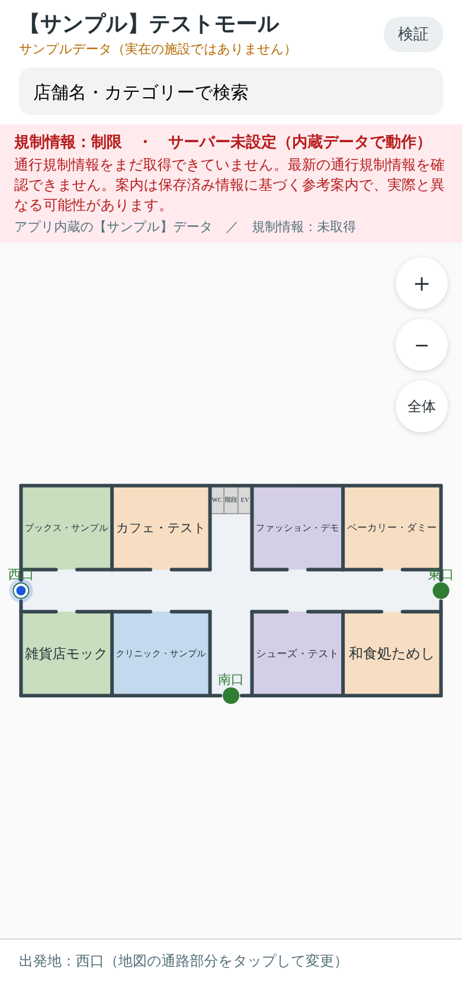
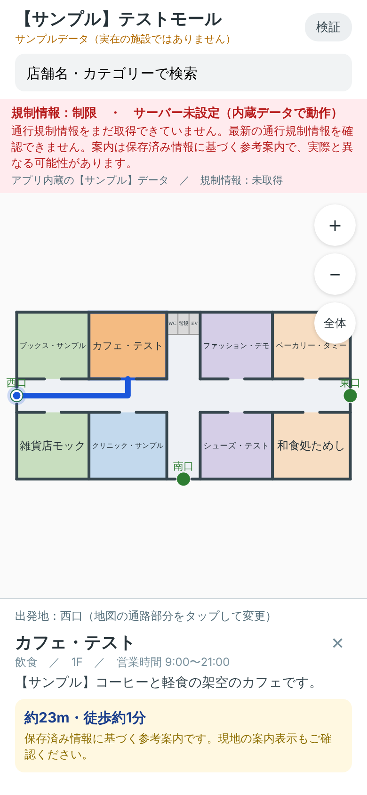
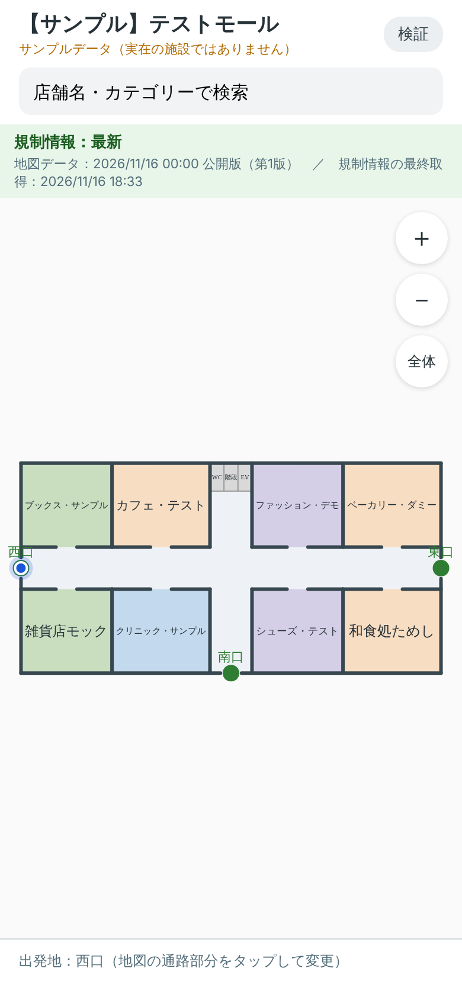
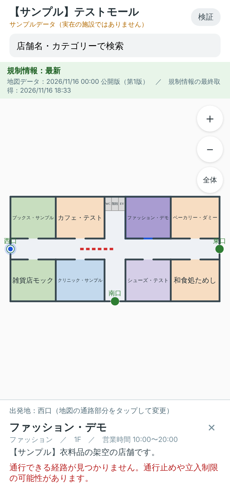
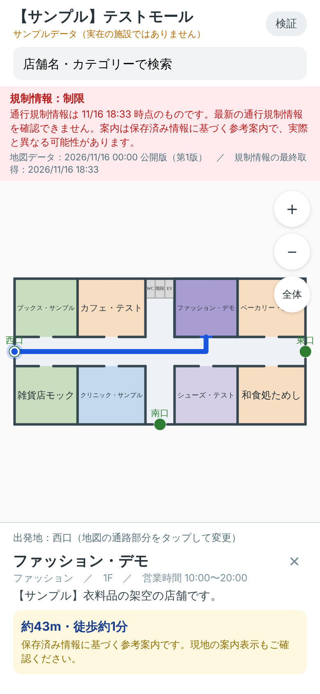
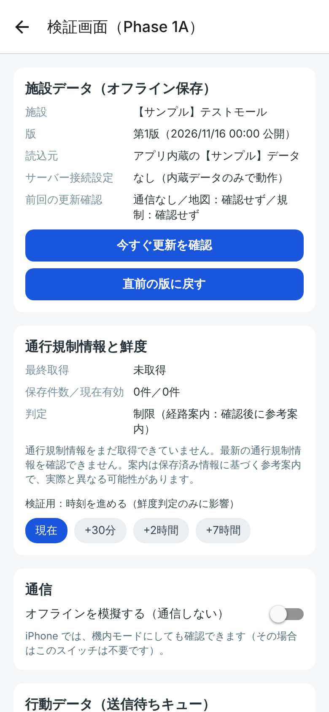

# Phase 1A 報告書（無料の範囲での実装・検証）

- 報告日：2026-11-16
- 対象：設計提案書 v1.0「10-3 Phase 1A」＋ 依頼者回答（D1〜D5・追加確認事項1〜4）
- 作業ブランチ：`claude/facility-navigation-poc-opq8ec`
- **費用：0円**（有料サービスの契約・機材の購入は行っていません）
- 状態：**Phase 1A の Claude Code 側の作業は完了。依頼者の iPhone・Supabase での確認待ち**

> 表記：✅ 実装済み（動作確認・テスト済み） ／ 🟡 仮実装・一部未確認（制約を併記） ／ ⬜ 未実施 ／ ⏸ 保留（判断・機材待ち） ／ ❌ 実装不可・代替

---

## 1. まとめ

| 項目 | 結果 |
|---|---|
| 自動テスト | **共通ロジック 54件・サンプルデータ 6件・DB権限 40件、すべて成功**。GitHub 上の自動テスト（CI）も成功 |
| 画面の通し検証（ブラウザ版アプリの自動操作） | サーバーなし：全手順成功／サーバーあり（本番と同じDB定義の検証用API）：**20項目すべて成功** |
| iPhone（Expo Go）での確認 | **未確認**（依頼者の確認待ち）。iOS 向けのアプリのビルド（バンドル作成）は成功 |
| 本物の Supabase への接続 | **未確認**（依頼者の無料プロジェクト作成待ち）。手順書を用意済み |
| Android エミュレーターでの MapLibre 表示 | **未実施**（理由と提案は 4章） |
| 技術的な問題 | **実装を止める必要のある問題は見つかっていません**。注意点は 5章 |

---

## 2. 実装したもの

### 2-1. 構成

```
apps/mobile/           利用者アプリ（Expo SDK 58 / React Native 0.88）
  src/app/index.tsx      地図画面（検索・店舗情報・経路・鮮度表示）
  src/app/debug.tsx      Phase 1A 検証画面（依頼者の動作確認用）
  src/components/        屋内マップ描画（SVG方式）・状態表示
  src/data/              データ取得・端末保存（iPhone/Android は SQLite、ブラウザは localStorage）
packages/core/         共通ロジック（経路探索・鮮度判定・検索・送信キュー・同期・座標変換）
packages/sample-data/  【サンプル】架空フロア（60m×30m、店舗8、出入口3、トイレ・階段・EV）
supabase/migrations/   DB定義（施設・フロア・権限の土台、公開データ配信、経路規制、行動データ受付）
supabase/tests/        DB権限テスト（pgTAP）
tools/verify/          画面の通し検証ツール（アプリ本体には含まれない）
docs/setup/            手順書（Windows、Supabase、iPhone 確認表）
docs/decisions/        判断ポイント G1 の判断材料
.github/workflows/     自動テスト（CI）
```

### 2-2. 機能と状態

| 機能 | 状態 | 確認方法・制約 |
|---|---|---|
| 屋内マップ表示（SVG描画、拡大縮小・移動・全体表示） | 🟡 | ブラウザ版で確認。**iPhone での指の操作（2本指ズーム）は未確認** |
| 店舗をタップ → 店舗情報（名称・カテゴリー・フロア・営業時間・説明） | ✅ | 自動操作で確認 |
| 店舗検索（名前・読み仮名・カテゴリー。ひらがな/カタカナ・全角/半角を区別しない） | ✅ | 単体テスト＋自動操作 |
| 経路探索（A*）：最短経路・壁を通らない・一方通行・通行禁止・一時封鎖・立入制限・推奨ルート・複数フロア | ✅ | 単体テスト（多フロアはテスト用データで確認） |
| 任意地点（地図タップ）からの経路。店舗の中からでも壁を越えずに入口経由 | ✅ | 単体テスト＋自動操作 |
| 通路ネットワークの検査（壁と交差する通路線・孤立点・入口のない店舗の検出） | ✅ | 単体テスト（管理画面の警告は Phase 4） |
| **オフライン**：施設データを端末に保存し、通信なしで地図・検索・経路 | ✅ | 検証用APIを止めて再起動しても動作（自動操作） |
| **オフライン**：版番号の確認 → 新しい版だけ取得、壊れたデータは保存しない、直前の版に戻せる | ✅ | 単体テスト＋自動操作 |
| **オフライン**：期間つき規制を端末内で自動適用・自動解除 | ✅ | 単体テスト＋自動操作（通信断のまま時刻経過） |
| **規制情報の鮮度**：正常／注意／制限、最終取得日時の表示、参考案内の明示 | ✅ | 単体テスト＋自動操作 |
| 鮮度：安全上重要な規制（重要度「高」）やイベント中は早く「制限」 | ✅ | 単体テスト＋自動操作 |
| 鮮度：施設ごとのしきい値・「確認後の参考案内／案内停止」の切替（地図の再公開なしで反映） | ✅ | DBテスト＋自動操作 |
| **行動データの一時保存と再送**（同意時のみ・通信断中は端末に保存・復旧後に送信） | ✅ | 単体テスト＋自動操作（ブラウザ版）。🟡 iPhone の SQLite 保存は未確認 |
| **重複防止**（サーバー保存後に応答が切れて再送しても1件） | ✅ | 単体テスト＋DBテスト＋自動操作 |
| 分析データ送信の同意（初期値「同意しない」、撤回で未送信分を削除） | 🟡 | 動作は確認済み。**検証画面の仮スイッチ**であり、本番の同意画面は Phase 6 |
| 匿名ID（1日ごとに作り直し） | ✅ | 単体テスト |
| DB：施設単位のアクセス制御、機能別権限、停止アカウントの無効化、最上位管理者は多要素認証時のみ特権、権限変更履歴（削除不可） | ✅ | DBテスト（40件） |
| DB：利用者アプリ向け関数（公開版番号・施設データ・経路規制・行動データ受付） | ✅ | DBテスト＋検証用API経由の自動操作 |

### 2-3. 画面（ブラウザ版での自動操作時のスクリーンショット。iPhone の表示とは細部が異なる場合があります）

| サーバーなし（内蔵サンプル） | 参考案内の経路 | サーバー接続・最新 |
|---|---|---|
|  |  |  |

| 通行止め（赤の破線）で経路なし | 規制情報が古い（制限）＋参考案内 | 検証画面 |
|---|---|---|
|  |  |  |

---

## 3. 検証結果

### 3-1. 自動テスト

| 種類 | 件数 | 結果 | 実行場所 |
|---|---|---|---|
| 共通ロジック（経路探索・鮮度判定・送信キュー・同期・検索・座標変換） | 54 | 全件成功 | Claude Code 環境、GitHub Actions |
| サンプルデータ（全出入口→全店舗に経路がある、壁と交差する通路線がない等） | 6 | 全件成功 | 同上 |
| DB 権限・公開データ・行動データ受付（pgTAP） | 40 | 全件成功 | 同上 |
| 型チェック・アプリのビルド（Web / iOS 向けバンドル） | ― | 成功 | 同上 |

GitHub Actions の実行結果：https://github.com/7zkv7bps5y-cell/claude/actions/runs/43930136582 （2つのジョブとも成功）

### 3-2. 画面の通し検証（サーバーあり・20項目）

本番と同じDB定義を適用した PostgreSQL と、Supabase の公開API（匿名ロール）を模した検証用サーバーに、ブラウザ版のアプリを接続して自動操作しました（`tools/verify/`）。結果の詳細：`docs/reports/phase-1a/e2e-online-results.json`

| # | 確認内容 | 結果 |
|---|---|---|
| 1 | 起動時にサーバーから地図・規制情報を取得し「最新」表示 | 成功 |
| 2 | 通行止めの追加が公開操作なしで反映され「経路なし」と案内 | 成功 |
| 3 | 開始前の一時封鎖は適用されず、通信断のまま開始時刻を過ぎると自動適用、終了後は自動解除 | 成功 |
| 3 | 最終取得から30分で「注意」、7時間で「制限」＋参考案内 | 成功 |
| 4 | 通信不可で再起動しても保存データで地図・検索・経路が使える | 成功 |
| 5 | 重要度「高」の規制があると2時間で「制限」 | 成功 |
| 6 | 施設設定を「案内停止」にすると、古い場合は経路案内を停止 | 成功 |
| 7 | 同意しない間は送信しない／同意後に送信 | 成功 |
| 8 | 通信不可の間は端末に保存し、再起動後も残り、復旧後に送信 | 成功 |
| 9 | サーバー保存後に応答が切れて再送しても重複しない | 成功 |
| 10 | 新しい版の取得・壊れた版の拒否・直前の版への復元 | 成功 |
| ― | ブラウザのエラーなし | 成功 |

**この検証の限界**：本物の Supabase ではなく同等の検証環境です。また iPhone ではなくブラウザ版です。iPhone 固有の部分（SQLite 保存、指の操作、機内モード）は依頼者の確認で補います（`docs/setup/03-iphone-check.md`）。

### 3-3. Supabase 無料枠でどこまで足りるか（実測に基づく試算）

【サンプル】行動データ 20万件を検証用DBに投入して容量を実測しました。

| 項目 | 実測・試算 |
|---|---|
| 行動データ1件あたりの容量（索引込み） | **約322バイト** |
| 無料枠のDB容量 | 500MB（超えると読み取り専用）。他データ・Supabase 標準機能用に100MBを確保すると、行動データに使えるのは約400MB |
| 保持できる件数 | 約120万件 |
| 生データ90日保存の場合 | **1日あたり約13,000件まで** |
| 利用者数に換算（分析に同意した利用者1人＝1日20件と仮定） | **1日あたり約650人**（同意率30%なら来訪アプリ利用者 約2,000人/日） |
| 施設データ（サンプル）の大きさ | 約22KB。200店舗規模の施設でも数百KB程度と見込む（端末へのダウンロードは版が変わったときのみ） |
| 結論 | **PoC（1施設・テスト利用）は無料枠で十分**。複数施設・本格運用では有料プラン（8GB、約16倍）が必要。集計済みデータへの置き換え（Phase 6）で生データの保存量はさらに減らせる |

※ Supabase 側の標準機能が使う容量は実物で未確認のため、本物のプロジェクト作成後に実測して補正します。

---

## 4. 未実施・未確認の項目と理由

| 項目 | 状態 | 理由 | 提案 |
|---|---|---|---|
| Windows PC での開発環境構築 | 🟡 | 依頼者の PC での作業が必要 | `docs/setup/01-windows-setup.md` に沿って実施をお願いします |
| iPhone（Expo Go）での表示確認 | 🟡 | 依頼者の iPhone での確認が必要 | `docs/setup/03-iphone-check.md` のチェック表 A をお願いします |
| 本物の Supabase（無料）への接続確認 | 🟡 | アカウント作成は依頼者の操作が必要 | `docs/setup/02-supabase-setup.md` → チェック表 B をお願いします |
| Android エミュレーターでの MapLibre 表示 | ⬜ | MapLibre は Expo Go で動かず、開発ビルド＋ Android Studio（依頼者の PC で数GBのダウンロードと設定）が必要。Claude Code の作業環境ではエミュレーターを動かせない | **Phase 1B で iPhone の MapLibre 確認と同時に行う**ことを提案（Android 用ビルドは Apple 登録不要。必要なら 1B の前に単独でも実施可能） |
| MapLibre の iPhone 表示 | ⏸ | Apple Developer Program 登録が必要（G1） | G1 の判断後 |
| BLE 測位の技術検証 | ⏸ | Apple 登録＋発信機が必要（G1） | G1 の判断後 |

---

## 5. 残課題・注意点

| # | 内容 | 影響 | 対応予定 |
|---|---|---|---|
| 1 | 行動データ受付に**回数制限がない**（匿名で呼べる関数のため、大量送信されうる） | 中（PoC では限定的） | Phase 6 で前段に Edge Function を置き回数制限（設計どおり）。それまでは本番公開しない |
| 2 | Expo Go は開発用のため、**機内モードでのアプリ起動**が制限される場合がある | 低 | 完全なオフライン起動は開発ビルド（1B）で確認。起動済みアプリの通信断は Expo Go でも確認可能 |
| 3 | SVG 描画は大規模施設（数百店舗）での動作速度が未確認 | 中 | G2（MapLibre との比較）で確認 |
| 4 | Supabase 無料プロジェクトの**1週間停止**対策（定期アクセス）、**毎日のバックアップ**は未設定 | 低（現時点で実データなし） | Supabase プロジェクト作成後、実データを入れ始める Phase 2 で GitHub Actions に設定 |
| 5 | 開発用ツールの依存部品に「中程度」の脆弱性警告が3件（`minimatch`、Expo のビルド用ツール経由） | 低（アプリ本体の実行部分ではなく、ビルド時の道具） | 修正には Expo の古い版への変更が必要なため見送り。Expo の更新で解消されるか監視 |
| 6 | 管理画面は未着手 | ― | Phase 2（設計どおり） |

---

## 6. 設計書 v1.0 からの細部の決定・変更（承認をお願いします）

実装の過程で、設計書に具体的な記載がなかった点を次のように決めました。**仕様の変更ではありませんが、ご確認ください。**

| # | 内容 | 理由 |
|---|---|---|
| 1 | 重要度「高」の規制がある場合・イベント中の「制限」しきい値の初期値を **60分** とした（施設ごとに変更可） | 設計書では「早く移行」とのみ記載していたため |
| 2 | 鮮度しきい値は施設データではなく**規制情報と一緒に配信** | 管理者がしきい値を変えたとき、地図の再公開なしで即時に反映させるため |
| 3 | Phase 1A の行動データ受付は DB 関数で実装（回数制限は Phase 6 の Edge Function で追加） | 無料・最小構成で重複防止を先に検証するため |
| 4 | **最上位管理者の特権は、DB 側で多要素認証済みのログインに限定済み** | 設計どおり（Q11）。このため Phase 2 の「最小ログイン」には**最上位管理者の多要素認証の登録画面を含める**必要があります |
| 5 | ブラウザ版アプリ（確認用）では端末保存に localStorage を使用 | ブラウザでの動作確認用。iPhone/Android は設計どおり SQLite |

---

## 7. 依頼者回答（D1〜D5・追加確認事項）への対応

| 項目 | 対応 |
|---|---|
| D1 無料の範囲に限定 | 費用0円。有料サービス・機材の購入なし |
| D2 鮮度しきい値・参考案内・安全上重要な規制での制限 | 施設ごとに変更可能。注意・制限時は「保存済み情報に基づく参考案内」を明示。重要度「高」で早期に制限、施設設定で案内停止も可能 |
| D3 同意の初期値「同意しない」・基本機能は同意なしで利用可 | 実装済み（同意なしでも地図・検索・経路はすべて利用可） |
| D4 ビーコン検出レポートは同意の対象・点検モード維持 | 行動データ種別 `beacon_seen` は同意時のみ送信される送信キュー経由に限定。点検モードは Phase 3（設計維持） |
| D5 架空フロア | 【サンプル】テストモールで開始。データ・画面・DBのすべてでサンプルと明示 |
| 追加1 BLE：架空フロアでの動作確認と実環境での精度評価を分ける | 下表のとおり区別します（設計書にも追記） |
| 追加2 オフライン経路案内は鮮度に応じて可否判断 | 実装・検証済み（3-2 #3〜#6） |
| 追加3 位置情報のプライバシー（集計・閲覧権限・少数データ非表示） | 生データは「利用者データ閲覧」権限者のみ閲覧可（DBで強制・テスト済み）。集計・少数データ非表示は Phase 6 で実装（設計維持） |
| 追加4 Apple 登録・ビーコン購入は 1A の結果を見て判断 | 判断材料を `docs/decisions/G1-apple-developer-and-beacons.md` に用意 |

**BLE 測位の2つの検証の区別（追加確認事項1）**

| | ① 架空フロアでの動作確認 | ② 実環境での精度評価 |
|---|---|---|
| 目的 | 測位の仕組みが**正しく動くか**（計算・画面・記録） | 測位が**どれくらい正確か** |
| 場所 | 【サンプル】テストモールの地図を、実際の部屋・廊下に重ねて使う（または記録済み電波データの再生） | 実際に測れる部屋・廊下 → 施設決定後は対象施設 |
| 使うもの | 発信機1台〜、記録済みの電波データ | 発信機3〜5台（ステップ2）、施設決定後は施設設置分 |
| 完成条件 | 位置が表示される・精度円・自動/手動補正の区別・未検出ビーコンの除外が動く | 評価地点ごとの誤差を記録し、中央値・店舗区画正答率を報告（暫定目標：中央値3m・80%。**達成は保証しない**） |
| 報告での扱い | 「動作確認済み」 | 「実測値◯m（目標◯m）」として数値で報告。架空フロアの結果を精度として報告しない |

---

## 8. 次の Phase で必要になる費用

| 選択肢 | 内容 | 費用 |
|---|---|---|
| Phase 1B に進む（推奨） | Apple Developer Program 登録＋発信機1台 → iPhone で MapLibre・BLE 受信を確認。Android 用開発ビルドでの MapLibre 確認も同時に実施 | **約1.6〜2万円**（年会費 約1.4〜1.5万円＋発信機 約2,000〜5,000円） |
| Apple 登録のみ | MapLibre の iPhone 確認のみ（BLE は保留） | 約1.4〜1.5万円 |
| Phase 1B を保留して Phase 2 へ | 管理画面（地図編集・最小ログイン＋最上位管理者の多要素認証）を Expo Go・ブラウザで開発 | **0円** |

詳細と名義の比較：`docs/decisions/G1-apple-developer-and-beacons.md`

---

## 9. 依頼者にお願いしたいこと

1. `docs/setup/01-windows-setup.md` で開発環境を準備し、`docs/setup/03-iphone-check.md` の **チェック表 A** を確認
2. （任意・無料）`docs/setup/02-supabase-setup.md` で Supabase を準備し、**チェック表 B** を確認
3. 6章の細部の決定（5項目）の確認
4. G1 の判断（Apple 登録・名義・発信機）。保留の場合は Phase 2 に進むかのご指示

iPhone での確認結果によって修正が必要になった場合は、Phase 1B／2 に進む前に修正します。
